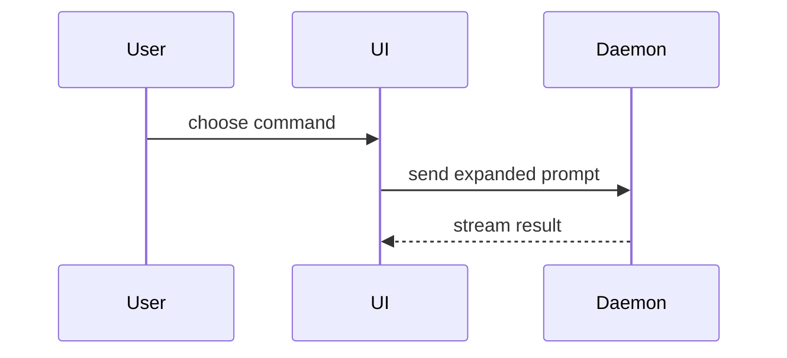

# mattpocock/skills — SKILL.md das pastas engineering e productivity

Fonte: https://github.com/mattpocock/skills (branch main), baixado em 2026-11-14 via raw.githubusercontent.com. Conteúdo literal, em inglês, concatenado sem edição; cada bloco começa com o caminho do arquivo.

=================== skills/engineering/ask-matt/SKILL.md ===================

---
name: ask-matt
description: Ask which skill or flow fits your situation. A router over the skills in this repo.
disable-model-invocation: true
---

# Ask Matt

You don't remember every skill, so ask.

Before stating what a skill does or recommending a step be skipped, read that skill's SKILL.md: the summaries here are for orientation only.

A **flow** is a path through the skills. Most paths run along one **main flow**, and two **on-ramps** merge onto it. Everything else is standalone, or a vocabulary layer that runs underneath.

## The main flow: idea → ship

The route most work travels. You have an idea and want it built.

1. **`/grill-with-docs`** sharpens the idea by interview. Start here whenever you are **working in a working directory**: it's stateful, retaining what it learns in `GLOSSARY.md` and ADRs. (No working directory? Use `/grill-me` instead, covered under Standalone. Both run the same `/grilling` primitive; `grill-with-docs` is the one that leaves a paper trail, which makes it the better of the two whenever a repo is there to leave it in.)
2. **Branch: can you settle every question in conversation?** If a question needs a runnable answer (state, business logic, a UI you have to see), detour through a prototype, bridged by **`/handoff`** in both directions (a prototype lives in its own directory, which is exactly what `/handoff` is for; see Phase boundaries):
   - **`/handoff`** out, then open a fresh session against that file,
   - **`/prototype`** to answer the question with throwaway code,
   - **`/handoff`** back what you learned, and reference it from the original idea thread.
3. **Branch: is this a multi-session build?**
   - **Yes** → **`/to-spec`** (turn the thread into a spec), then **`/to-tickets`** to split it into tracer-bullet tickets, each declaring its **blocking edges**. Then work the tickets one of two ways:
     - **`/implement`** per ticket, **`/clear`ing context between each one**. On a local tracker that's one file per ticket under `.scratch/<feature>/issues/`, worked blockers-first by hand; on a real tracker the edges become native blocking links, so any ticket whose blockers are done can be grabbed. Each ticket is self-contained, so the last one's context is disposable.
     - **`/implement-spec`** for the whole spec in one run. It reads the tickets as a **task graph**, runs implementer subagents across the ready **frontier** in parallel, and lands everything on one **integration branch**. Reach for it when you'd rather orchestrate the build than drive each ticket yourself.
   - **No** → **`/implement`** right here, in the same context window.

   Either way, the code gets built by driving **`/tdd`** (one red-green slice at a time) and closes out with **`/code-review`**, a two-axis review (Standards + Spec) of the diff. `/implement` runs both per ticket; `/implement-spec`'s implementers each drive `/tdd`, and it runs one `/code-review` over the integration branch. Reach for **`/tdd`** on its own when you just want to build a concrete behaviour test-first without a full spec, and **`/code-review`** on its own whenever you want to review a branch or PR against a fixed point.

   When the work goes up as a pull request, **`/pr`** shapes the body: the smallest visual that shows the change, before/after evidence that it works, and a one-way or two-way door call. It's model-invoked, so the agent reaches for it whenever it writes a PR.

4. **`/retro`** closes the loop. After a build, and especially one that went sideways, it looks back over the session and suggests changes to the agent's **environment**, not the code: navigation pointers, automated checks, the coding standards `/code-review` enforces, steering files, tooling. Mechanical mistakes become deterministic checks; judgement calls become coding standards. The next build then starts from a better environment.

### Context hygiene

Keep steps 1–3 in **one unbroken context window** (don't compact or clear until after `/to-tickets`) so the grilling, spec, and tickets all build on the same thinking. Each `/implement` then starts fresh, working from the ticket. Run `/retro` in the session it's looking back on, before you clear; after clearing, point it at that session's log instead.

The limit on this is the **[smart zone](https://www.aihero.dev/ai-coding-dictionary/smart-zone)**: the window (~150k tokens on state-of-the-art models) within which the model still reasons sharply. If a session approaches it before `/to-tickets`, don't push on degraded; `/compact` at the nearest phase boundary and carry on (see Phase boundaries).

## On-ramps

A starting situation that generates work, then merges onto the main flow.

- **Bugs and requests piling up** → **`/triage`**. It moves issues through triage roles and produces agent-ready issues, which **`/implement`** later picks up.

  Triage is only for issues **you didn't create**: bug reports, incoming feature requests, anything that arrives raw. Tickets that `/to-tickets` produced are already agent-ready, so **don't triage them**.

- **Something's broken** → **`/diagnosing-bugs`**. For the hard ones: the bug that resists a first glance, the intermittent flake, the regression that crept in between two known-good states. It refuses to theorise until it has a **tight feedback loop** (one command that already goes red on *this* bug), then fixes with a regression test. Once the fix is in, run **`/retro`** in the same session to ask what would have prevented the bug; where the real finding is that there's no good seam to lock it down, that's a job for **`/improve-codebase-architecture`**.

- **A huge, foggy effort: a greenfield project or a huge feature build, too big for one session** → **`/wayfinder`**, the most cognitively demanding flow here. When the way from here to the destination isn't visible yet, it charts a **shared map** of **decision tickets** on the issue tracker and resolves them one at a time, producing **decisions, not deliverables**, until the fog is pushed back and the way is clear. Where **`/grill-with-docs`** sharpens an idea you can hold in one session, wayfinder is for the idea you can't, and it's slower and denser, so save it for exactly that, never a well-scoped feature.

  When the map clears, **it hands off, it doesn't build**: merge onto the main flow at **`/to-spec`**, which collapses the map's linked decisions into a buildable plan, then `/to-tickets` and `/implement` as usual. Looping the map straight into `/implement` skips that collapse and throws the linked detail away, so go straight to `/implement` only when the effort turned out genuinely small.

## Codebase health

Not feature work, just upkeep.

- **`/improve-codebase-architecture`** runs whenever you have a spare moment to keep the codebase good for agents to operate in. It surfaces **deepening opportunities**; picking one _generates an idea_ you can take into the main flow at `/grill-with-docs`. It's the survey that finds the candidates; **`/codebase-design`** (below) is the bench you design the chosen one on.

## Vocabulary underneath

Two model-invoked references that run *beneath* the other skills, each the single source of truth for its vocabulary. Reach for them directly when the **words**, not the process, are the problem; or let the skills above pull them in.

- **`/domain-modeling`**: sharpen the project's *domain* language: challenge a fuzzy term, resolve an overloaded word ("account" doing three jobs), record a hard-to-reverse decision as an ADR. It's the active discipline `/grill-with-docs` drives to keep `GLOSSARY.md` a clean glossary.
- **`/codebase-design`** is the deep-module vocabulary (module, interface, depth, seam, adapter, leverage, locality) for designing a module's *shape*: a lot of behaviour behind a small interface at a clean seam. `/tdd` and `/improve-codebase-architecture` both speak it.

## Phase boundaries

A **phase** is a chunk of work inside a session: the grilling, the implementation, the QA. At the **boundary** between two of them you have five options, and picking between them is the fuzziest decision in this whole map:

- **Continue**: stay put. Costs nothing, loses nothing.
- **`/clear`**: empty the window, when nothing here matters to what's next.
- **`/handoff`** writes a portable markdown file. Narrow: only for a **new harness**, a **new directory**, a **colleague**, or forking a side task **mid-phase**. What it buys is portability.
- **Subagent**: send a tightly-scoped task to its own window and get a report back.
- **`/compact`** compresses this context and seeds a fresh session with it. The **default**, at the bottom of the tree rather than the first reach.

Read [PHASE-BOUNDARIES.md](PHASE-BOUNDARIES.md) for the ordered tree: the five questions, the reasoning behind each branch, and why the primary-source cost makes **Continue** the one to rule out first. Make the decision **at** a boundary; mid-phase, continue or split the rest into subagents.

## Standalone

Off the main flow entirely.

- **`/grill-me`**: the same relentless interview as `/grill-with-docs`, but **stateless**: it saves nothing locally and builds no `GLOSSARY.md`. Reach for it when you are **not working in a working directory** (sharpening a plan, a design, a piece of writing, anything with no repo under it). If you are in a working directory, use `/grill-with-docs` instead: it runs the same interview and leaves a paper trail, so it is strictly the better one.
- **`/grilling`** is the interview primitive itself: rounds, the frontier, facts are the agent's job and decisions are yours. `/grill-me` and `/grill-with-docs` are the two named ways in, and `/triage`, `/wayfinder` and `/improve-codebase-architecture` all run it internally. Reach for it directly only when you want the interview with no wrapper around it.
- **`/prototype`** is a small, throwaway program that answers one design question: does this state model feel right, or what should this UI look like. Throwaway is a constraint on how the code is written, not a promise to destroy it: the answer folds into the real code, and the prototype itself is kept as a **primary source** on a `prototype/<name>` branch out of main, pointed at from the implementation issue. It's the detour in step 2 of the main flow, but reach for it any time a design question is hard to settle on paper.
- **`/research`**: delegate reading legwork to a **background agent**: it investigates a question against **primary sources**, then leaves a cited Markdown file in the repo. Keep working while it reads. The file it produces is something to take *into* the main flow at `/grill-with-docs`, since research feeds the thinking rather than replacing it.
- **`/to-questionnaire`** comes in when the thing blocking you isn't in your head or the codebase but in **someone else's**, and it writes them a questionnaire to fill in. It's the inverse of `/grill-me`: instead of interviewing you about the subject, it interviews you about the **send** (who it's going to, what you need back) and aims the questions at the gap. What comes back is material for `/grill-with-docs` or `/to-spec`.
- **`/wizard`** is for the steps only a **human** can take: provisioning infrastructure, setting up credentials or CI secrets, clicking through an unfamiliar third-party dashboard, running a one-off migration or cutover. It generates an interactive bash script that opens each URL, captures each value, and writes it into `.env` and GitHub secrets, so the procedure stops being something you re-explain to an agent every time. Model-invoked, so the agent reaches for it the moment it hits a wall only you can pass. If the agent could just do it itself, it should; this is for where a human is genuinely in the loop.
- **`/wait-what`** is the corrective for a message that didn't land. Use it mid-conversation, inside any other skill, and the agent re-pitches what it just said with the context you were missing, in plain English, using the `GLOSSARY.md` vocabulary. It works after the fact; `/grill-with-docs` is the upfront cure, because a shared language agreed early is what stops the jargon arriving at all.
- **`/teach`**: learn a concept over multiple sessions, using the current directory as a stateful workspace.
- **`/writing-for-agents`** is the reference for writing documents agents consume: skills, AGENTS.md, pointed-at docs.

## Precondition

**`/setup-matt-pocock-skills`**: run before your first engineering flow to configure the issue tracker, triage labels, and doc layout the other skills assume. Custom issue trackers also work.

=================== skills/engineering/grill-with-docs/SKILL.md ===================

---
name: grill-with-docs
description: A relentless interview to sharpen a plan or design, which also creates docs (ADR's and glossary) as we go.
disable-model-invocation: true
---

Call the Skill tool twice, for "grilling" and "domain-modeling".

=================== skills/engineering/triage/SKILL.md ===================

---
name: triage
description: Move issues and external PRs through a state machine of triage roles, categorise, verify, grill if needed, and write agent-ready briefs.
disable-model-invocation: true
---

# Triage

Move issues on the project issue tracker through a small state machine of triage roles.

If this repo treats external pull requests as a request surface (see the issue-tracker config), triage covers them too: **a PR is an issue with attached code**, using the same roles, same states, and same machine, with a few deltas marked "for a PR" below. Resolve a bare `#42` to an issue or PR per the tracker config.

Every comment or issue posted to the issue tracker during triage **must** start with this disclaimer:

```
> *This was generated by AI during triage.*
```

## Reference docs

- [AGENT-BRIEF.md](AGENT-BRIEF.md): how to write durable agent briefs
- [OUT-OF-SCOPE.md](OUT-OF-SCOPE.md): how the `.out-of-scope/` knowledge base works

## Roles

Two **category** roles:

- `bug`: something is broken
- `enhancement`: new feature or improvement

Five **state** roles:

- `needs-triage`: maintainer needs to evaluate
- `needs-info`: waiting on reporter for more information
- `ready-for-agent`: fully specified, ready for an AFK agent
- `ready-for-human`: needs human implementation
- `wontfix`: will not be actioned

For a PR, the same states read against the attached code: `ready-for-agent` means a brief is attached and an agent should take the next step on the diff; `ready-for-human` means it's ready for a human to merge.

Every triaged issue should carry exactly one category role and one state role. If state roles conflict, flag it and ask the maintainer before doing anything else.

These are canonical role names. The actual label strings used in the issue tracker may differ. The mapping should have been provided to you. If not, tell the user to run `/setup-matt-pocock-skills`.

State transitions: an unlabeled issue normally goes to `needs-triage` first; from there it moves to `needs-info`, `ready-for-agent`, `ready-for-human`, or `wontfix`. `needs-info` returns to `needs-triage` once the reporter replies. The maintainer can override at any time; flag transitions that look unusual and ask before proceeding.

## Invocation

The maintainer invokes `/triage` and describes what they want in natural language. Interpret the request and act. Examples:

- "Show me anything that needs my attention"
- "Let's look at #42" (issue or PR)
- "Move #42 to ready-for-agent"
- "What's ready for agents to pick up?"

## Show what needs attention

Query the issue tracker and present three buckets, oldest first:

1. **Unlabeled**: never triaged.
2. **`needs-triage`**: evaluation in progress.
3. **`needs-info` with reporter activity since the last triage notes**: needs re-evaluation.

When PRs are in scope, include external PRs in these buckets and tag each line `[PR]` or `[issue]`. Discovery surfaces only *external* PRs (the tracker config defines who counts as external), so a collaborator's in-flight PR is not triage work. This filter is discovery-only; an explicitly named PR is always triaged regardless of author.

Show counts and a one-line summary per item. Let the maintainer pick.

## Triage a specific issue or PR

1. **Gather context.** Read the full issue or PR (body, comments, labels, author, dates; for a PR, the diff too). Parse any prior triage notes so you don't re-ask resolved questions. Explore the codebase using the project's domain glossary, respecting ADRs in the area. Run two checks against the codebase: (a) **redundancy**: search for an existing implementation of the requested behavior by domain concept (not just the request's wording), and report where you looked. If found, it's an already-implemented `wontfix` (step 5). (b) **prior rejection**: read `.out-of-scope/*.md` and surface any that resembles this request.

2. **Recommend.** Tell the maintainer your category and state recommendation with reasoning, plus a brief codebase summary relevant to the request (including whether it's already implemented). Wait for direction.

3. **Verify the claim.** Before any grilling, check that the claim holds up. For a bug, reproduce it from the reporter's steps. For a PR, confirm the diff does what it claims: check it out, run the relevant tests or commands. Report what happened: confirmed (with code path), failed, or insufficient detail (a strong `needs-info` signal). A confirmed verification makes a much stronger agent brief.

4. **Grill (if needed).** If the request needs fleshing out, call the Skill tool twice, for "grilling" and "domain-modeling", and grill it into shape a round of questions at a time, sharpening domain terms and updating `GLOSSARY.md`/ADRs inline as decisions land.

5. **Apply the outcome:**
   - `ready-for-agent`: post an agent brief comment ([AGENT-BRIEF.md](AGENT-BRIEF.md)).
   - `ready-for-human`: same structure as an agent brief, but note why it can't be delegated (judgment calls, external access, design decisions, manual testing).
   - `needs-info`: post triage notes (template below).
   - For `wontfix`, close the issue, with the comment depending on *why*:
     - **Already implemented**: the change already exists in the codebase. Point to where it lives; do **not** write to `.out-of-scope/` (that KB is for *rejected* requests, not built ones).
     - **Rejected (bug)**: give a polite explanation, then close.
     - **Rejected (enhancement)**: write to `.out-of-scope/`, link to it from a comment, then close ([OUT-OF-SCOPE.md](OUT-OF-SCOPE.md)).
   - `needs-triage`: apply the role. Optional comment if there's partial progress.

## Quick state override

If the maintainer says "move #42 to ready-for-agent", trust them and apply the role directly. Confirm what you're about to do (role changes, comment, close), then act. Skip grilling. If moving to `ready-for-agent` without a grilling session, ask whether they want to write an agent brief.

## Needs-info template

```markdown
## Triage Notes

**What we've established so far:**

- point 1
- point 2

**What we still need from you (@reporter):**

- question 1
- question 2
```

Capture everything resolved during grilling under "established so far" so the work isn't lost. Questions must be specific and actionable, not "please provide more info".

## Resuming a previous session

If prior triage notes exist on the issue or PR, read them, check whether the reporter has answered any outstanding questions, and present an updated picture before continuing. Don't re-ask resolved questions.

=================== skills/engineering/improve-codebase-architecture/SKILL.md ===================

---
name: improve-codebase-architecture
description: Scan a codebase for deepening opportunities, present them as a visual HTML report, then grill through whichever one you pick.
disable-model-invocation: true
---

# Improve Codebase Architecture

Surface architectural friction and propose **deepening opportunities**: refactors that turn shallow modules into deep ones. The aim is testability and AI-navigability.

This command is _informed_ by the project's domain model and built on a shared design vocabulary:

- Call the Skill tool with "codebase-design" for the architecture vocabulary (**module**, **interface**, **depth**, **seam**, **adapter**, **leverage**, **locality**) and its principles (the deletion test, "the interface is the test surface", "one adapter = hypothetical seam, two = real"). Use these terms exactly in every suggestion, and don't drift into "component," "service," "API," or "boundary."
- The domain language in `GLOSSARY.md` gives names to good seams; ADRs in `docs/adr/` record decisions this command should not re-litigate.

## Process

### 1. Explore

**Scope before you scan: YAGNI.** Deepening a module pays off by making future changes to it easier, so put extra weight on the parts of the codebase that have recently changed. Decide *where* to look before you look:

- If the user named a direction (a module, a subsystem, a pain point), take it, and skip the inference below.
- Otherwise, walk back a good stretch of the commit history (`git log --oneline`) to find the codebase's hot spots, the files and areas that keep coming up, and let those paths pull your attention first. If the changes are scattered with no clear hot spot, widen the net.

Read the project's domain glossary (`GLOSSARY.md`) and any ADRs in the area you're touching first.

Then spawn a sub-agent with a fresh context window to walk the codebase. Don't follow rigid heuristics; explore organically and note where you experience friction:

- Where does understanding one concept require bouncing between many small modules?
- Where are modules **shallow**, with an interface nearly as complex as the implementation?
- Where have pure functions been extracted just for testability, but the real bugs hide in how they're called (no **locality**)?
- Where do tightly-coupled modules leak across their seams?
- Which parts of the codebase are untested, or hard to test through their current interface?

Apply the **deletion test** to anything you suspect is shallow: would deleting it concentrate complexity, or just move it? A "yes, concentrates" is the signal you want.

### 2. Present candidates as an HTML report

Write a self-contained HTML file to the OS temp directory so nothing lands in the repo. Resolve the temp dir from `$TMPDIR`, falling back to `/tmp` (or `%TEMP%` on Windows), and write to `<tmpdir>/architecture-review-<timestamp>.html` so each run gets a fresh file. Open it for the user (`xdg-open <path>` on Linux, `open <path>` on macOS, `start <path>` on Windows) and tell them the absolute path.

The report uses **Tailwind via CDN** for layout and styling, and **Mermaid via CDN** for diagrams where a graph/flow/sequence reliably communicates the structure. Mix Mermaid with hand-crafted CSS/SVG visuals: use Mermaid when relationships are graph-shaped (call graphs, dependencies, sequences), and hand-built divs/SVG when you want something more editorial (mass diagrams, cross-sections, collapse animations). Each candidate gets a **before/after visualisation**. Be visual.

For each candidate, render a card with:

- **Files**: which files/modules are involved
- **Problem**: why the current architecture is causing friction
- **Solution**: plain English description of what would change
- **Benefits**: explained in terms of locality and leverage, and how tests would improve
- **Before / After diagram**: side-by-side, custom-drawn, illustrating the shallowness and the deepening
- **Recommendation strength**: one of `Strong`, `Worth exploring`, `Speculative`, rendered as a badge

End the report with a **Top recommendation** section: which candidate you'd tackle first and why.

**Use GLOSSARY.md vocabulary for the domain, and the `/codebase-design` vocabulary for the architecture.** If `GLOSSARY.md` defines "Order," talk about "the Order intake module," not "the FooBarHandler," and not "the Order service."

**ADR conflicts**: if a candidate contradicts an existing ADR, only surface it when the friction is real enough to warrant revisiting the ADR. Mark it clearly in the card (e.g. a warning callout: _"contradicts ADR-0007, but worth reopening because…"_). Don't list every theoretical refactor an ADR forbids.

See [HTML-REPORT.md](HTML-REPORT.md) for the full HTML scaffold, diagram patterns, and styling guidance.

Do NOT propose interfaces yet. After the file is written, ask the user: "Which of these would you like to explore?"

### 3. Grilling loop

Once the user picks a candidate, call the Skill tool with "grilling" to walk the decision tree with them: constraints, dependencies, the shape of the deepened module, what sits behind the seam, what tests survive.

Side effects happen inline as decisions crystallize; call the Skill tool with "domain-modeling" to keep the domain model current as you go:

- **Naming a deepened module after a concept not in `GLOSSARY.md`?** Add the term to `GLOSSARY.md`. Create the file lazily if it doesn't exist.
- **Sharpening a fuzzy term during the conversation?** Update `GLOSSARY.md` right there.
- **User rejects the candidate with a load-bearing reason?** Offer an ADR, framed as: _"Want me to record this as an ADR so future architecture reviews don't re-suggest it?"_ Only offer when the reason would actually be needed by a future explorer to avoid re-suggesting the same thing; skip ephemeral reasons ("not worth it right now") and self-evident ones.
- **Want to explore alternative interfaces for the deepened module?** Call the Skill tool with "codebase-design" and use its design-it-twice parallel sub-agent pattern.

=================== skills/engineering/setup-matt-pocock-skills/SKILL.md ===================

---
name: setup-matt-pocock-skills
description: "Configure this repo for the engineering skills: set up its issue tracker, triage label vocabulary, and domain doc layout. Run once before first use of the other engineering skills."
disable-model-invocation: true
---

# Setup Matt Pocock's Skills

Scaffold the per-repo configuration that the engineering skills assume:

- **Issue tracker**: where issues live (GitHub by default; local markdown is also supported out of the box)
- **Triage labels**: the strings used for the five canonical triage roles
- **Domain docs**: where `GLOSSARY.md` and ADRs live, and the consumer rules for reading them

This is a prompt-driven skill, not a deterministic script. Explore, present what you found, confirm with the user, then write.

## Process

### 1. Explore

Look at the current repo to understand its starting state. Read whatever exists; don't assume:

- `git remote -v` and `.git/config`: is this a GitHub repo? Which one?
- `AGENTS.md` and `CLAUDE.md` at the repo root: does either exist? Is there already an `## Agent skills` section in either?
- `GLOSSARY.md` and `GLOSSARY-MAP.md` at the repo root, and the legacy `CONTEXT.md` / `CONTEXT-MAP.md`. If a legacy file exists, offer to `git mv` it to its `GLOSSARY` name and rewrite those names in `docs/agents/domain.md`.
- `docs/adr/` and any `src/*/docs/adr/` directories
- `docs/agents/`: does this skill's prior output already exist?
- `.scratch/`: a sign that a local-markdown issue tracker convention is already in use
- Is the `triage` skill installed? (a `triage` skill folder alongside this one, or `triage` in your available skills.) This decides whether Section B runs at all.
- Monorepo signals: a `pnpm-workspace.yaml`, a `workspaces` field in `package.json`, or a populated `packages/*` with its own `src/`. These are present only in a genuinely large multi-package repo; their absence means single-context, which is almost every repo.

### 2. Present findings and ask

Summarise what's present and what's missing. Then take the sections in order. One section, one answer, then the next.

Lead each section with the recommended answer so the user can accept it in a word. Give a one-line explainer only when the choice genuinely branches; skip the section entirely when exploration already settled it (Section B when `triage` isn't installed, Section C when there's no monorepo).

**Section A: Issue tracker.**

> Explainer: The "issue tracker" is where issues live for this repo. Skills like `to-tickets`, `triage`, and `to-spec` read from and write to it. They need to know whether to call `gh issue create`, write a markdown file under `.scratch/`, or follow some other workflow you describe. Pick the place you actually track work for this repo.

Default posture: these skills were designed for GitHub. If a `git remote` points at GitHub, propose that. If a `git remote` points at GitLab (`gitlab.com` or a self-hosted host), propose GitLab. Otherwise (or if the user prefers), offer:

- **GitHub**: issues live in the repo's GitHub Issues (uses the `gh` CLI)
- **GitLab**: issues live in the repo's GitLab Issues (uses the [`glab`](https://gitlab.com/gitlab-org/cli) CLI)
- **Local markdown**: issues live as files under `.scratch/<feature>/` in this repo (good for solo projects or repos without a remote)
- **Other** (Jira, Linear, etc.): ask the user to describe the workflow in one paragraph; the skill will record it as freeform prose

Record the choice in `docs/agents/issue-tracker.md`. The GitHub and GitLab templates carry a "PRs as a request surface" flag, defaulted **off**. Leave it off and don't raise it: a user who wants external PRs in the triage queue can flip the flag in the file later.

A GitHub or GitLab tracker needs a reachable repo. When the user picks one and no `git remote` points at that host, get the repo URL from them and wire it up (`git init` if needed, `git remote add origin <url>`) before going further. Done when `gh repo view` / `glab repo view` prints the project from inside this directory; if it can't, stop and tell the user what's missing.

**Section B: Triage label vocabulary.** Skip this section entirely if the `triage` skill isn't installed (exploration told you), since an uninstalled skill needs no labels.

If it is installed, ask exactly one question:

> Do you want to keep the default triage labels? (recommended: **yes**)

The defaults are the five canonical roles, each label string equal to its name: `needs-triage`, `needs-info`, `ready-for-agent`, `ready-for-human`, `wontfix`. On **yes**, write them as-is. Only if the user says no, usually because their tracker already uses other names (e.g. `bug:triage` for `needs-triage`), collect the overrides so `triage` applies existing labels instead of creating duplicates.

**Section C: Domain docs.** Default to **single-context** (one `GLOSSARY.md` + `docs/adr/` at the repo root). This fits almost every repo; write it without asking.

Offer **multi-context** (a root `GLOSSARY-MAP.md` pointing to per-context `GLOSSARY.md` files) only when exploration found monorepo signals. Then confirm which layout they want.

### 3. Confirm and edit

Show the user a draft of:

- The `## Agent skills` block to add to whichever of `CLAUDE.md` / `AGENTS.md` is being edited (see step 4 for selection rules)
- The contents of `docs/agents/issue-tracker.md`, `docs/agents/domain.md`, and `docs/agents/triage-labels.md` (the last only when `triage` is installed)

Let them edit before writing.

### 4. Write

**Pick the file to edit:**

- If `CLAUDE.md` exists, edit it.
- Else if `AGENTS.md` exists, edit it.
- If neither exists, ask the user which one to create; don't pick for them.

Never create `AGENTS.md` when `CLAUDE.md` already exists (or vice versa); always edit the one that's already there.

If an `## Agent skills` block already exists in the chosen file, update its contents in-place rather than appending a duplicate. Don't overwrite user edits to the surrounding sections.

The block:

```markdown
## Agent skills

### Issue tracker

[one-line summary of where issues are tracked]. See `docs/agents/issue-tracker.md`.

### Triage labels

[one-line summary of the label vocabulary]. See `docs/agents/triage-labels.md`.

### Domain docs

[one-line summary of layout: "single-context" or "multi-context"]. See `docs/agents/domain.md`.
```

Include the `### Triage labels` sub-block, and write `docs/agents/triage-labels.md`, only when `triage` is installed and Section B ran. When it isn't, both are omitted.

When Section B ran on GitHub or GitLab, create each configured label the tracker lacks (`gh label create` / `glab label create`).

Then write the docs files using the seed templates in this skill folder as a starting point:

- [issue-tracker-github.md](./issue-tracker-github.md): GitHub issue tracker
- [issue-tracker-gitlab.md](./issue-tracker-gitlab.md): GitLab issue tracker
- [issue-tracker-local.md](./issue-tracker-local.md): local-markdown issue tracker
- [triage-labels.md](./triage-labels.md): label mapping (only if `triage` is installed)
- [domain.md](./domain.md): domain doc consumer rules + layout

For "other" issue trackers, write `docs/agents/issue-tracker.md` from scratch using the user's description.

### 5. Done

Tell the user the setup is complete and which engineering skills will now read from these files. Mention they can edit `docs/agents/*.md` directly later; re-running this skill is only necessary if they want to switch issue trackers or restart from scratch.

=================== skills/engineering/to-spec/SKILL.md ===================

---
name: to-spec
description: "Turn the current conversation into a spec and publish it to the project issue tracker: no interview, just synthesis of what you've already discussed."
disable-model-invocation: true
---

This skill takes the current conversation context and codebase understanding and produces a spec. Do NOT interview the user; just synthesize what you already know.

The issue tracker and triage label vocabulary should have been provided to you. If not, tell the user to run `/setup-matt-pocock-skills`.

## Process

1. Explore the repo to understand the current state of the codebase, if you haven't already. Use the project's domain glossary vocabulary throughout the spec, and respect any ADRs in the area you're touching.

2. Sketch out the seams at which you're going to test the feature. Existing seams should be preferred to new ones. Use the highest seam possible. If new seams are needed, propose them at the highest point you can. The fewer seams across the codebase, the better - the ideal number is one.

Check with the user that these seams match their expectations.

3. Write the spec using the template below, then publish it to the project issue tracker. Apply the `ready-for-agent` triage label - no need for additional triage.

<spec-template>

## Problem Statement

The problem that the user is facing, from the user's perspective.

## Solution

The solution to the problem, from the user's perspective.

## User Stories

A LONG, numbered list of user stories. Each user story should be in the format of:

1. As an <actor>, I want a <feature>, so that <benefit>

<user-story-example>
1. As a mobile bank customer, I want to see balance on my accounts, so that I can make better informed decisions about my spending
</user-story-example>

This list of user stories should be extremely extensive and cover all aspects of the feature.

## Implementation Decisions

A list of implementation decisions that were made. This can include:

- The modules that will be built/modified
- The interfaces of those modules that will be modified
- Technical clarifications from the developer
- Architectural decisions
- Schema changes
- API contracts
- Specific interactions

Do NOT include specific file paths or code snippets. They may end up being outdated very quickly.

Exception: if a prototype produced a snippet that encodes a decision more precisely than prose can (state machine, reducer, schema, type shape), inline it within the relevant decision and note briefly that it came from a prototype. Trim to the decision-rich parts, not a working demo, just the important bits.

## Testing Decisions

A list of testing decisions that were made. Include:

- A description of what makes a good test (only test external behavior, not implementation details)
- Which modules will be tested
- Prior art for the tests (i.e. similar types of tests in the codebase)

## Out of Scope

A description of the things that are out of scope for this spec.

## Further Notes

Any further notes about the feature.

</spec-template>

=================== skills/engineering/to-tickets/SKILL.md ===================

---
name: to-tickets
description: Break a plan, spec, or the current conversation into a set of tracer-bullet tickets, each declaring its blocking edges, published to the configured tracker (edges as text in one file per ticket locally, or native blocking links on a real tracker).
disable-model-invocation: true
---

# To Tickets

Break a plan, spec, or conversation into a set of **tickets**: tracer-bullet vertical slices, each declaring the tickets that **block** it.

The issue tracker and triage label vocabulary should have been provided to you. If not, tell the user to run `/setup-matt-pocock-skills`.

## Process

### 1. Gather context

Work from whatever is already in the conversation context. If the user passes a reference (a spec path, an issue number or URL) as an argument, fetch it and read its full body and comments.

### 2. Explore the codebase (optional)

If you have not already explored the codebase, do so to understand the current state of the code. Ticket titles and descriptions should use the project's domain glossary vocabulary, and respect ADRs in the area you're touching.

Look for opportunities to prefactor the code to make the implementation easier. "Make the change easy, then make the easy change."

### 3. Draft vertical slices

Break the work into **tracer bullet** tickets.

<vertical-slice-rules>

- Each slice cuts a narrow but COMPLETE path through every layer (schema, API, UI, tests): vertical, NOT a horizontal slice of one layer
- A completed slice is demoable or verifiable on its own
- Each slice is sized to fit in a single fresh context window
- Any prefactoring should be done first

</vertical-slice-rules>

Give each ticket its **blocking edges**: the other tickets that must complete before it can start. A ticket with no blockers can start immediately.

**Wide refactors are the exception to vertical slicing.** A **wide refactor** is one mechanical change (rename a column, retype a shared symbol) whose **blast radius** fans across the whole codebase, so a single edit breaks thousands of call sites at once and no vertical slice can land green. Don't force it into a tracer bullet; sequence it as **expand–contract**. First expand: add the new form beside the old so nothing breaks. Then migrate the call sites over in batches sized by blast radius (per package, per directory), each batch its own ticket blocked by the expand, keeping CI green batch to batch because the old form still exists. Finally contract: delete the old form once no caller remains, in a ticket blocked by every migrate batch. When even the batches can't stay green alone, keep the sequence but let them share an integration branch that all block a final integrate-and-verify ticket; green is promised only there.

### 4. Quiz the user

Present the proposed breakdown as a numbered list. For each ticket, show:

- **Title**: short descriptive name
- **Blocked by**: which other tickets (if any) must complete first
- **What it delivers**: the end-to-end behaviour this ticket makes work

Ask the user:

- Does the granularity feel right? (too coarse / too fine)
- Are the blocking edges correct: does each ticket only depend on tickets that genuinely gate it?
- Should any tickets be merged or split further?

Iterate until the user approves the breakdown.

### 5. Publish the tickets to the configured tracker

Publish the approved tickets. **How** depends on the tracker `/setup-matt-pocock-skills` configured; the tickets are the same either way, only the shape of the blocking edges changes:

- **Local files** → write one file per ticket under `.scratch/<feature-slug>/issues/<NN>-<slug>.md`, numbered from `01` in dependency order (blockers first). Each file's "Blocked by" lists the numbers/titles it depends on. Use the per-ticket file template below: one ticket per file, never a single combined file.
- **A real issue tracker (GitHub, Linear, …)** → publish one issue per ticket in dependency order (blockers first) so each ticket's blocking edges can reference real identifiers. Use the platform's native blocking relationship where it has one; otherwise set each ticket's "Blocked by" to the blocking issues. If the source was an existing issue, make each ticket its sub-issue (tracker doc's operation). Apply the `ready-for-agent` triage label unless instructed otherwise; the tickets are agent-grabbable by construction.

Work the **frontier**: any ticket whose blockers are all done. For a purely linear chain that means top to bottom.

Do NOT close or modify any parent issue.

<local-ticket-template>

# <NN>: <Ticket title>

**What to build:** the end-to-end behaviour this ticket makes work, from the user's perspective, not a layer-by-layer implementation list.

**Blocked by:** the numbers/titles of the tickets that gate this one, or "None (can start immediately)".

**Status:** ready-for-agent

- [ ] Acceptance criterion 1
- [ ] Acceptance criterion 2

</local-ticket-template>

<issue-template>

## Parent

A reference to the parent issue on the tracker (if the source was an existing issue, otherwise omit this section).

## What to build

The end-to-end behaviour this ticket makes work, from the user's perspective, not layer-by-layer implementation.

## Acceptance criteria

- [ ] Criterion 1
- [ ] Criterion 2

## Blocked by

- A reference to each blocking ticket, or "None (can start immediately)". Omit this section when blockers were set as native edges.

</issue-template>

In either form, avoid specific file paths or code snippets: they go stale fast. Exception: if a prototype produced a snippet that encodes a decision more precisely than prose can (state machine, reducer, schema, type shape), inline it and note briefly that it came from a prototype. Trim to the decision-rich parts, not a working demo, just the important bits.

=================== skills/engineering/implement/SKILL.md ===================

---
name: implement
description: "Implement a piece of work based on a spec or set of tickets."
disable-model-invocation: true
---

Implement the work described by the user in the spec or tickets.

If the user passes a ticket reference, fetch it from the issue tracker and state its title before starting. If the reference is ambiguous, ask.

Call the Skill tool with "tdd" where possible, at pre-agreed seams.

Run typechecking regularly, single test files regularly, and the full test suite once at the end.

Once done, call the Skill tool with "code-review" to review the work.

Commit your work to the current branch.

=================== skills/engineering/implement-spec/SKILL.md ===================

---
name: implement-spec
description: "Implement the result of /to-spec and /to-tickets in code."
disable-model-invocation: true
---

You have been provided a spec. This spec should have tickets associated with it, describing how to implement the spec.

The issue tracker should have been provided to you. If not, tell the user to run `/setup-matt-pocock-skills`.

The goal is the entire spec implemented on a single **integration branch**, with every ticket resolved the way the issue tracker closes work.

The tickets are not a list of steps. They are a **task graph** with blocking relationships between them. This means there is always a **frontier** of tickets which are ready to be grabbed.

Start every subagent with a fresh context window.

Communication to and from subagents should be sparse. Communicate primarily through **context pointers**: to the spec, tickets, research notes, and previous commits. Don't duplicate information already available via pointers.

**Implementer subagents** should be run in the background where possible for maximum concurrency.

## Steps

1. Read the spec and tickets to understand the task graph.

2. (optional) Use an **exploration subagent** to conduct any exploration required by the tickets - relevant codebase files or external documentation. Ensure the exploration subagent can save files - it should save its markdown notes in a directory outside the repo, accessible by all future subagents. This lets **implementer subagents** focus on implementation rather than exploration.

3. Create the integration branch. If the issue tracker closes work through PRs, or the user asks for one, open a draft PR after the first merge in step 5 (a branch with no commits ahead of main can't open one), marked as closing the spec and tickets.

4. Use a fresh **implementer subagent** for each ticket, each in its own worktree on its own branch. Each implementer subagent:
   - confirms its worktree is based on the integration branch before starting, and resets onto it if not;
   - calls the Skill tool with `tdd` to build the ticket;
   - merges the integration branch tip into its own branch before reporting done

5. Once an **implementer subagent** completes, merge its work to the integration branch with a **merger subagent**.

6. If this changes the **frontier** of available tickets, kick off more **implementer subagents** to work on the new tickets. This allows for maximum concurrency.

7. Once all tickets are complete, call the Skill tool with `code-review` on the integration branch. Fix all issues raised by the code review in a single fresh **implementer subagent**.

8. If a draft PR exists, mark it ready for review. Otherwise, resolve each ticket the way the issue tracker closes work, and report the integration branch.

9. Clean up all **implementer subagent** worktrees.

=================== skills/engineering/wayfinder/SKILL.md ===================

---
name: wayfinder
description: Plan a huge chunk of work (more than one agent session can hold) as a shared map of decision tickets on your issue tracker, and resolve them one at a time until the way to the destination is clear.
disable-model-invocation: true
---

A loose idea has arrived, too big for one agent session, and wrapped in fog: the way from here to the **destination** isn't visible yet. Wayfinding is about finding that way, not charging at the destination. This skill charts the way as a **shared map** on the repo's issue tracker, then works its **decision tickets** (questions whose resolution is a decision, not slices of a build to execute) one at a time until the route is clear.

The destination varies per effort, and naming it is the first act of charting: it shapes every ticket. It might be a spec to hand off and iterate on, a decision to lock before planning starts, or a change made in place like a data-structure migration. The map is domain-agnostic: engineering work, course content, whatever fits the shape.

## Plan, don't do

Wayfinder is **planning** by default: each ticket resolves a decision, and the map is done when the way is clear, with nothing left to decide before someone goes and does the thing. The pull to just do the work is usually the signal you've reached the edge of the map and it's time to hand off. An effort can override this in its **Notes**, carrying execution into the map itself, but absent that, produce decisions, not deliverables.

## Refer by name

Every map and ticket is an issue, so it has a **name**: its title. In everything the human reads (narration, the map's Decisions-so-far), refer to it by that name, never by a bare id, number, or slug. A wall of `#42, #43, #44` is illegible; names read at a glance. The id and URL don't vanish; a name wraps its link, but they ride _inside_ the name, never stand in for it.

## The Map

The map is a single issue on this repo's issue tracker, labelled `wayfinder:map`, the canonical artifact. Its tickets are child issues of the map.

The map is an **index**, not a store. It lists the decisions made and points at the tickets that hold their detail; a decision lives in exactly one place, its ticket, so the map never restates it, only gists it and links.

**Where the map, its child tickets, blocking, and frontier queries physically live is tracker-specific.** The issue tracker should have been provided to you. If not, tell the user to run `/setup-matt-pocock-skills`. Consult the tracker doc's "Wayfinding operations" section for how _this_ repo expresses them. If no tracker has been provided, default to the local-markdown tracker.

### The map body

The whole map at low resolution, loaded once per session. Open tickets are **not** listed: they are open child issues, found by query.

```markdown
## Destination

<what reaching the end of this map looks like: the spec, decision, or change this effort is finding its way to. One or two lines; every session orients to it before choosing a ticket.>

## Notes

<domain; skills every session should consult; standing preferences for this effort>

## Decisions so far

<!-- the index: one line per closed ticket, enough to judge relevance, then zoom the link for the detail the ticket holds -->

- [<closed ticket title>](link): <one-line gist of the answer>

## Not yet specified

<!-- see "Fog of war": in-scope fog you can't ticket yet; graduates as the frontier advances -->

## Out of scope

<!-- see "Out of scope": work ruled beyond the destination; closed, never graduates -->
```

### Tickets

Each ticket is a **child issue** of the map; the tracker's issue id is its identity. Its body is the question, sized to one 100K token agent session:

```markdown
## Question

<the decision or investigation this ticket resolves>
```

Each ticket carries a `wayfinder:<type>` label, one of `research`, `prototype`, `grilling`, `task` (see [Ticket Types](#ticket-types)). `wayfinder:` labels are the only labels a map and its tickets carry, never a triage label like `ready-for-agent`: they are decisions, not implementation work.

A session **claims** a ticket by assigning it to the dev driving the map, **first**, before any work, so concurrent sessions skip it. That assignee _is_ the claim: an open, unassigned ticket is unclaimed.

Blocking uses the tracker's **native** dependency relationship: essential because it renders the frontier _visually_ in the tracker's own UI, so the human sees what's takeable without opening the map. Only a tracker that lacks native blocking falls back to a body convention. A ticket is **unblocked** when every ticket blocking it is closed; the **frontier** is the open, unblocked, unclaimed children, the edge of the known.

The answer isn't part of the body; it's recorded on resolution (see [Work through the map](#work-through-the-map)). Assets created while resolving a ticket are linked from the issue, not pasted in.

## Ticket Types

Every ticket is either **HITL** (human in the loop, worked _with_ a human who speaks for themselves) or **AFK**, driven by the agent alone. A HITL ticket only resolves through that live exchange; the agent never stands in for the human's side of it (a grilling agent that answers its own questions has broken this).

- **Research** (AFK): Reading documentation, third-party APIs, or local resources like knowledge bases to surface a fact a decision waits on. Resolved by a subagent that calls the Skill tool with "research". Use when knowledge outside the current working directory is required.
- **Prototype** (HITL): Raise the fidelity of the discussion by making a cheap, rough, concrete artifact to react to (an outline, a rough take, a stub, or UI/logic code) by calling the Skill tool with "prototype". Links the prototype as an asset. Use when "how should it look" or "how should it behave" is the key question.
- **Grilling** (HITL): Conversation. The default case. Always call the Skill tool twice, for "grilling" and "domain-modeling".
- **Task** (HITL or AFK): Manual work that must happen before a _decision_ can be made: nothing to decide, prototype, or research, but the discussion is blocked until it's done. Signing up for a service so its API can be judged, provisioning access, moving data so its shape can be seen. This is the one type that _does_ rather than decides, and it earns its place by unblocking a decision, not by delivering the destination. The agent drives it alone where it can (AFK); otherwise it hands the human a precise checklist (HITL). Resolved when the work is done; the answer records what was done and any resulting facts (credentials location, new URLs, row counts) later tickets depend on.

## Fog of war

The map is _deliberately_ incomplete: don't chart what you can't yet see. Beyond the live tickets lies the **fog of war**: the dim view of decisions and investigations you can tell are coming but can't yet pin down, because they hang on questions still open. Resolving a ticket clears the fog ahead of it, graduating whatever's now specifiable into fresh tickets, one at a time, until the way to the destination is clear and no tickets remain.

The map's **Not yet specified** section is where that dim view is written down: the suspected question, the area to revisit later. It's the undiscovered frontier _toward_ the destination: everything here is in scope, just not sharp enough to ticket. Write as loosely or as fully as the view allows; it doubles as a signpost for collaborators reading where the effort is headed.

**Fog or ticket?** The test is whether you can state the question precisely now, _not_ whether you can answer it now.

- **Ticket when** the question is already sharp, even if it's blocked and you can't act on it yet.
- **Not yet specified when** you can't yet phrase it that sharply. Don't pre-slice the fog into ticket-sized pieces: it's coarser than a ticket, and one patch may graduate into several tickets, or none, once the frontier reaches it.

**Not yet specified** excludes what's already decided (Decisions so far), what's already a live ticket, and what's out of scope (the next section).

## Out of scope

Fog only ever gathers _toward_ the destination. The destination fixes the scope, so work beyond it is **out of scope**: it isn't fog, and it doesn't belong in **Not yet specified**. It gets its own **Out of scope** section on the map: work you've consciously ruled out of _this_ effort. Scope, not sharpness, lands it here.

Out-of-scope work never graduates (the frontier stops at the destination), so it returns only if the destination is redrawn, and then as a fresh effort, not a resumption.

Ruling something out of scope is a scoping act, not a step on the route. When a ticket that already exists turns out to sit past the destination (mis-scoped in while charting, or exposed by a resolution), **close it** (a closed ticket is unambiguously off the frontier) and leave one line in the **Out of scope** section: the gist plus why it's out of scope, linking the closed ticket. It stays out of **Decisions so far**, which records the route actually walked; a scope boundary isn't a step on it.

## Invocation

Two modes. Either way, **never resolve more than one ticket per session**, with the exception of research tickets.

### Chart the map

User invokes with a loose idea.

1. **Name the destination.** Call the Skill tool twice, for "grilling" and "domain-modeling", to pin down what this map is finding its way to: the spec, decision, or change. The destination fixes the scope, so it's settled first.
2. **Map the frontier.** Grill again, **breadth-first** this time: fan out across the whole space rather than deep on any one thread, surfacing the open decisions and the first steps takeable now. **If this surfaces no fog** (the way to the destination is already clear, the whole journey small enough for one session), you don't need a map. Stop and ask the user how they'd like to proceed.
3. **Create the map** (label `wayfinder:map`): Destination and Notes filled in, Decisions-so-far empty, the fog sketched into **Not yet specified**.
4. **Create the tickets you can specify now** as child issues of the map, then wire blocking edges in a **second pass** (issues need ids before they can reference each other). Write cross-references in that pass too, with real ids: a placeholder `#<n>` auto-links to an unrelated issue. Wiring sorts them into the frontier and the blocked; everything you can't yet specify stays in the fog: the **Not yet specified** section.
5. **Fire the research subagents.** For each `research` ticket you just created, spin up a subagent with a fresh context window that calls the Skill tool with "research" to resolve it in parallel, capturing its findings on a throwaway `research/<name>` branch with a context pointer from the ticket. Push the branch but open no PR: it is never merged.
6. Stop: charting is one session's work; it hand-resolves nothing.

### Work through the map

User invokes with a map (URL or number). A ticket is **optional**: without one, you pick the next decision, not the user.

1. Load the **map**: the low-res view, not every ticket body.
2. Choose the ticket. If the user named one, use it. Otherwise take the first frontier ticket in order. **Claim it**: assign it to yourself before any work.
3. Resolve it as the type its `wayfinder:<type>` label names (see [Ticket Types](#ticket-types)). Read the label, not just the body: the body never states the type. **Zoom as needed**: fetch the full body of any related or closed ticket on demand; call the Skill tool for whichever skills the `## Notes` block names. If in doubt, call the Skill tool twice, for "grilling" and "domain-modeling".
4. Record the resolution: post the answer as a **resolution comment**, **close** the issue, and **append a context pointer** to the map's Decisions-so-far.
5. Add newly-surfaced tickets (create-then-wire); graduate any fog the answer has made specifiable, clearing each graduated patch from **Not yet specified** so it lives only as its new ticket. If the answer reveals that a ticket (this one or another) sits beyond the destination, **rule it out of scope** rather than resolving it on the route. If the decision invalidates other parts of the map, update or delete those tickets.

The user may run unblocked tickets in parallel, so expect other sessions to be editing the tracker concurrently.

=================== skills/engineering/retro/SKILL.md ===================

---
name: retro
description: "Conduct a retrospective on a coding session."
disable-model-invocation: true
---

The user has asked for a **retrospective**. You are suggesting improvements to the coding agent's **environment** to improve future runs.

## Steps

1. Call the Skill tool with `writing-for-agents` for the writing style guide.

2. Read the primary sources for the session the user specifies. This may mean searching through session logs on this machine. If the user doesn't specify a session, default to the current one.

3. Look for candidates for improvement in these categories.

- **Navigation**: how easy was it for the agent to find the right files? Are there hidden dependencies between files? Would a **navigation pointer** make it easier? _Use when_ the session took a long time to find a piece of information.
- **Automated checks**: are there automated checks that could catch errors the agent made? Linting, typing, tests, filesystem linters? Read the repo's own check command first (its `package.json`/build-tool `lint`/`check` scripts, its CI workflow), so a check that already exists but sits unwired or silently broken is the finding, not a reinvention. A repo with no **guardrail** (no pre-commit hook and no CI job running its lint/typecheck/test command) is itself a finding: an un-linted repo is a standing missed opportunity, not a neutral default. _Use when_ the agent made a mistake an automated check could have caught, or the repo has no guardrail at all.
- **Coding standards**: should the **reviewer agent** be given a new rule to enforce? Should an existing rule be removed or clarified? Classify the violation first: a **mechanical** one (a fixed syntactic pattern, a banned API, an import shape, a file-location rule) gets a deterministic check, full stop: a custom rule in the repo's own linter, a new pre-commit hook, or a new CI job, whichever the repo's language and existing guardrail make cheapest. Default to building the check over writing the rule. Reserve `CODING_STANDARDS.md` for genuine **judgement calls** (cross-file consistency, "matches the surrounding style," anything no guardrail could ever substitute for). _Use when_ the reviewer agent failed to catch a mistake.
- **Global AGENTS.md**: are there any steering instructions that should be moved to coding standards (or automated checks) instead? _Use when_ the AGENTS.md file is particularly large - in the repo OR the user's global scope.
- **Tool economy**: did the agent make expensive tool calls that could be streamlined? Is there any custom tooling (CLI's, MCP's) that is particularly token-inefficient? _Use when_ the agent made an expensive tool call.
- **No-ops**: look for instructions in steering files that don't modify the agent's behavior. _Use when_ the steering files are large and unwieldy.
- **Information access**: look for opportunities to increase the agent's access to information. Teeing dev server logs, readonly access to third-party services. _Use when_ a crucial piece of information was not available to the agent.

4. Present these candidates to the user, in order of severity.

## Reference

### Implementation vs Review

Remember that all work goes through two stages: implementation and review. The implementation agent has the most **context pressure**. They are responsible for exploration, writing code, and debugging failures.

The review agent has the least context pressure - it receives a diff, so no exploration needed. It often does not need to write code or debug.

This means that the review agent should be responsible for imposing coding standards, not the implementation agent.

### Files

You have access to several files in the repo:

- `CLAUDE.md`/`AGENTS.md`: these files are pushed to the context window of any agent working in this repo. They should be used incredibly sparingly, usually only for **navigation pointers** to other files.
- `CODING_STANDARDS.md`: this file is read during review, not implementation. Add **navigation pointers** to docs folders if the standards file gets more than 1,000 lines long.
- Docs: use docs as references files, pointed to by other files. Look for existing docs before writing new ones.
- Skills: use skills for docs (since their description goes into the agent's context window), or for user-invoked commands. Follow the advice in the `writing-for-agents` skill.

=================== skills/engineering/prototype/SKILL.md ===================

---
name: prototype
description: Build a throwaway prototype to answer a design question. Use when the user wants to sanity-check whether a state model or logic feels right, or explore what a UI should look like.
---

# Prototype

A prototype is **throwaway code that answers a question**. The question decides the shape.

## Pick a branch

Identify which question is being answered, using the user's prompt, the surrounding code, or by asking if the user is around:

- **"Does this logic / state model feel right?"** → [LOGIC.md](LOGIC.md). Build a single shareable HTML file (free-play buttons plus tabbed guided walkthroughs) that pushes the state machine through cases that are hard to reason about on paper, and that a non-developer can drive.
- **"What should this look like?"** → [UI.md](UI.md). Generate several radically different UI variations on a single route, switchable via a URL search param and a floating bottom bar.

The two branches produce very different artifacts, so getting this wrong wastes the whole prototype. If the question is genuinely ambiguous and the user isn't reachable, default to whichever branch better matches the surrounding code (a backend module → logic; a page or component → UI) and state the assumption at the top of the prototype.

## Rules that apply to both

1. **Throwaway from day one, and clearly marked as such.** Locate the prototype code close to where it will actually be used (next to the module or page it's prototyping for) so context is obvious, but name it so a casual reader can see it's a prototype, not production. For throwaway UI routes, obey whatever routing convention the project already uses; don't invent a new top-level structure.
2. **Trivial to run.** A UI prototype starts from one command in the project's task runner: `pnpm <name>`, `python <path>`, `bun <path>`, etc. A logic demo is a single HTML file the user double-clicks. Either way, no thinking required to start it.
3. **No persistence by default.** State lives in memory. Persistence is the thing the prototype is _checking_, not something it should depend on. If the question explicitly involves a database, hit a scratch DB or a local file with a clear "PROTOTYPE, wipe me" name.
4. **Skip the polish.** No tests, no error handling beyond what makes the prototype _runnable_, no abstractions. The point is to learn something fast.
5. **Surface the state.** After every action (logic) or on every variant switch (UI), print or render the full relevant state so the user can see what changed.
6. **Capture it when done.** Fold any validated decision into the real code, then capture the prototype itself as a **primary source**: commit it to a throwaway branch, out of main, and leave a context pointer to that branch on the implementation issue. Capture the answer too (the verdict and the question it settled) in the issue or a commit. The main branch keeps only the validated decision.

=================== skills/engineering/diagnosing-bugs/SKILL.md ===================

---
name: diagnosing-bugs
description: Diagnosis loop for hard bugs and performance regressions. Use when the user says "diagnose"/"debug this", or reports something broken/throwing/failing/slow.
---

# Diagnosing Bugs

A discipline for hard bugs. Skip phases only when explicitly justified.

When exploring the codebase, read `GLOSSARY.md` (if it exists) to get a clear mental model of the relevant modules, and check ADRs in the area you're touching.

## Redact

This skill has you show commands, outputs and captured artifacts. **Redact every secret first**: write `<REDACTED>` in its place. Build loops against env vars, so the credential stays in the environment rather than in what you show. Captured artifacts carry auth headers: quote only the lines that carry the signal.

If the redacted output is not enough to diagnose the bug, say so and ask the user.

## Phase 1: Build a feedback loop

**This is the skill.** Everything else is mechanical. If you have a **tight** pass/fail signal for the bug (one that goes red on _this_ bug), you will find the cause; bisection, hypothesis-testing, and instrumentation all just consume it. If you don't have one, no amount of staring at code will save you.

Spend disproportionate effort here. **Be aggressive. Be creative. Refuse to give up.**

### Ways to construct one, in roughly this order

1. **Failing test** at whatever seam reaches the bug: unit, integration, e2e.
2. **Curl / HTTP script** against a running dev server.
3. **CLI invocation** with a fixture input, diffing stdout against a known-good snapshot.
4. **Headless browser script** (Playwright / Puppeteer) that drives the UI and asserts on DOM/console/network.
5. **Replay a captured trace.** Save a real network request / payload / event log to disk; replay it through the code path in isolation.
6. **Throwaway harness.** Spin up a minimal subset of the system (one service, mocked deps) that exercises the bug code path with a single function call.
7. **Property / fuzz loop.** If the bug is "sometimes wrong output", run 1000 random inputs and look for the failure mode.
8. **Bisection harness.** If the bug appeared between two known states (commit, dataset, version), automate "boot at state X, check, repeat" so you can `git bisect run` it.
9. **Differential loop.** Run the same input through old-version vs new-version (or two configs) and diff outputs.
10. **HITL bash script.** Last resort. If a human must click, drive _them_ with `scripts/hitl-loop.template.sh` so the loop is still structured. Captured output feeds back to you.

Build the right feedback loop, and the bug is 90% fixed.

### Tighten the loop

Treat the loop as a product. Once you have _a_ loop, **tighten** it:

- Can I make it faster? (Cache setup, skip unrelated init, narrow the test scope.)
- Can I make the signal sharper? (Assert on the specific symptom, not "didn't crash".)
- Can I make it more deterministic? (Pin time, seed RNG, isolate filesystem, freeze network.)

A 30-second flaky loop is barely better than no loop; a 2-second deterministic one is tight, a debugging superpower.

### Non-deterministic bugs

The goal is not a clean repro but a **higher reproduction rate**. Loop the trigger 100×, parallelise, add stress, narrow timing windows, inject sleeps. A 50%-flake bug is debuggable; 1% is not, so keep raising the rate until it's debuggable.

### When you genuinely cannot build a loop

Stop and say so explicitly. List what you tried. Ask the user for: (a) access to whatever environment reproduces it, (b) a redacted captured artifact (HAR file, log dump, core dump, screen recording with timestamps), or (c) permission to add temporary production instrumentation. Do **not** proceed to hypothesise without a loop.

### Completion criterion: a tight loop that goes red

Phase 1 is done when the loop is **tight** and **red-capable**: you can name **one command** (a script path, a test invocation, a curl) that you have **already run at least once** (show the invocation and its output, redacted), and that is:

- [ ] **Red-capable**: it drives the actual bug code path and asserts the **user's exact symptom**, so it can go red on this bug and green once fixed. Not "runs without erroring"; it must be able to _catch this specific bug_.
- [ ] **Deterministic**: same verdict every run (flaky bugs: a pinned, high reproduction rate, per above).
- [ ] **Fast**: seconds, not minutes.
- [ ] **Agent-runnable**: you can run it unattended; a human in the loop only via `scripts/hitl-loop.template.sh`.

If you catch yourself reading code to build a theory before this command exists, **stop: jumping straight to a hypothesis is the exact failure this skill prevents.** No red-capable command, no Phase 2.

## Phase 2: Reproduce + minimise

Run the loop. Watch it go red as the bug appears.

Confirm:

- [ ] The loop produces the failure mode the **user** described, not a different failure that happens to be nearby. Wrong bug = wrong fix.
- [ ] The failure is reproducible across multiple runs (or, for non-deterministic bugs, reproducible at a high enough rate to debug against).
- [ ] You have captured the exact symptom (error message, wrong output, slow timing) so later phases can verify the fix actually addresses it.

### Minimise

Once it's red, shrink the repro to the **smallest scenario that still goes red**. Cut inputs, callers, config, data, and steps **one at a time**, re-running the loop after each cut, and keep only what's load-bearing for the failure.

Why bother: a minimal repro shrinks the hypothesis space in Phase 3 (fewer moving parts left to suspect) and becomes the clean regression test in Phase 5.

Done when **every remaining element is load-bearing**: removing any one of them makes the loop go green.

Do not proceed until you have reproduced **and** minimised.

## Phase 3: Hypothesise

Generate **3–5 ranked hypotheses** before testing any of them. Single-hypothesis generation anchors on the first plausible idea.

Each hypothesis must be **falsifiable**: state the prediction it makes.

> Format: "If <X> is the cause, then <changing Y> will make the bug disappear / <changing Z> will make it worse."

If you cannot state the prediction, the hypothesis is a vibe: discard or sharpen it.

**Show the ranked list to the user before testing.** They often have domain knowledge that re-ranks instantly ("we just deployed a change to #3"), or know hypotheses they've already ruled out. Cheap checkpoint, big time saver. Don't block on it; proceed with your ranking if the user is AFK.

## Phase 4: Instrument

Each probe must map to a specific prediction from Phase 3. **Change one variable at a time.**

Tool preference:

1. **Debugger / REPL inspection** if the env supports it. One breakpoint beats ten logs.
2. **Targeted logs** at the boundaries that distinguish hypotheses.
3. Never "log everything and grep".

**Tag every debug log** with a unique prefix, e.g. `[DEBUG-a4f2]`. Cleanup at the end becomes a single grep. Untagged logs survive; tagged logs die.

**Perf branch.** For performance regressions, logs are usually wrong. Instead: establish a baseline measurement (timing harness, `performance.now()`, profiler, query plan), then bisect. Measure first, fix second.

## Phase 5: Fix + regression test

Write the regression test **before the fix**, but only if there is a **correct seam** for it.

A correct seam is one where the test exercises the **real bug pattern** as it occurs at the call site. If the only available seam is too shallow (single-caller test when the bug needs multiple callers, unit test that can't replicate the chain that triggered the bug), a regression test there gives false confidence.

**If no correct seam exists, that itself is the finding.** Note it. The codebase architecture is preventing the bug from being locked down. Flag this for the next phase.

If a correct seam exists:

1. Turn the minimised repro into a failing test at that seam.
2. Watch it fail. If you forced the red by mutating code or a fixture, `diff` against a pristine copy to prove the mutation landed before you trust it.
3. Apply the fix.
4. Watch it pass.
5. Re-run the Phase 1 feedback loop against the original (un-minimised) scenario.

## Phase 6: Cleanup

Required before declaring done:

- [ ] Original repro no longer reproduces (re-run the Phase 1 loop)
- [ ] Regression test passes (or absence of seam is documented)
- [ ] All `[DEBUG-...]` instrumentation removed (`grep` the prefix)
- [ ] Throwaway prototypes deleted (or moved to a clearly-marked debug location)
- [ ] The hypothesis that turned out correct is stated in the commit / PR message, so the next debugger learns

=================== skills/engineering/research/SKILL.md ===================

---
name: research
description: Investigate a question against high-trust primary sources and capture the findings as a Markdown file in the repo. Use when the user wants a topic researched, docs or API facts gathered, or reading legwork delegated to a background agent.
---

Spin up a **background agent** to do the research, so you keep working while it reads. Start it with a fresh context window.

Its job:

1. Investigate the question against **primary sources** (official docs, source code, specs, first-party APIs), not a secondary write-up of them. Follow every claim back to the source that owns it.
2. Write the findings to a single Markdown file, citing each claim's source.
3. Save it where the repo already keeps such notes; match the existing convention, and if there is none, put it somewhere sensible and say where.

=================== skills/engineering/tdd/SKILL.md ===================

---
name: tdd
description: Test-driven development. Use when the user wants to build features or fix bugs test-first, mentions "red-green-refactor", or wants integration tests.
---

# Test-Driven Development

TDD is the red → green loop. This skill is the reference that makes that loop produce tests worth keeping: what a good test is, where tests go, the anti-patterns, and the rules of the loop. Every section applies on every cycle: consult them before and during the loop, not after.

When exploring the codebase, read `GLOSSARY.md` (if it exists) so test names and interface vocabulary match the project's domain language, and respect ADRs in the area you're touching.

## What a good test is

Tests verify behavior through public interfaces, not implementation details. Code can change entirely; tests shouldn't. A good test reads like a specification: "user can checkout with valid cart" tells you exactly what capability exists, and it survives refactors because it doesn't care about internal structure.

See [tests.md](tests.md) for examples and [mocking.md](mocking.md) for mocking guidelines.

## Seams: where tests go

A **seam** is the public boundary you test at: the interface where you observe behavior without reaching inside. Tests live at seams, never against internals.

**Test only at pre-agreed seams.** Before writing any test, write down the seams under test and confirm them with the user. No test is written at an unconfirmed seam. You can't test everything, so agreeing the seams up front is how testing effort lands on the critical paths and complex logic instead of every edge case.

Ask: "What's the public interface, and which seams should we test?" Give each proposed seam a one-line note on what it catches and what it misses.

When the shape of that interface is itself in question (how deep the module is, where the seam belongs, what the interface should expose), call the Skill tool with "codebase-design" for the vocabulary. It is the shared source of the module, interface, depth, seam, adapter, leverage and locality terms, and it is a reference to consult, not a session to run.

## Anti-patterns

- **Implementation-coupled**: mocks internal collaborators, tests private methods, or verifies through a side channel (querying the database instead of using the interface). The tell: the test breaks when you refactor but behavior hasn't changed.
- **Tautological**: the assertion recomputes the expected value the way the code does (`expect(add(a, b)).toBe(a + b)`, a snapshot derived by hand the same way, a constant asserted equal to itself), so it passes by construction and can never disagree with the code. Expected values must come from an independent source of truth: a known-good literal, a worked example, the spec.
- **Horizontal slicing**: writing all tests first, then all implementation. Bulk tests verify _imagined_ behavior: you test the _shape_ of things rather than user-facing behavior, the tests go insensitive to real changes, and you commit to test structure before understanding the implementation. Work in **vertical slices** instead: one test → one implementation → repeat, each test a **tracer bullet** that responds to what the last cycle taught you.

## Rules of the loop

- **Red before green.** Write the failing test first, then only enough code to pass it. Don't anticipate future tests or add speculative features.
- **One slice at a time.** One seam, one test, one minimal implementation per cycle.
- **Refactoring is not part of the loop.** It belongs to the review stage (see the `code-review` skill), not the red → green implementation cycle.

=================== skills/engineering/domain-modeling/SKILL.md ===================

---
name: domain-modeling
description: Build and sharpen a project's domain model. Use when discussing codebase terminology, writing or editing a GLOSSARY.md, or recording or editing an ADR.
---

# Domain Modeling

Actively build and sharpen the project's domain model as you design. This is the *active* discipline: challenging terms, inventing edge-case scenarios, and writing the glossary and decisions down the moment they crystallise. (Merely *reading* `GLOSSARY.md` for vocabulary is not this skill: that's a one-line habit any skill can do. This skill is for when you're changing the model, not just consuming it.)

## File structure

Most repos have a single context:

```
/
├── GLOSSARY.md
├── docs/
│   └── adr/
│       ├── 0001-event-sourced-orders.md
│       └── 0002-postgres-for-write-model.md
└── src/
```

If a `GLOSSARY-MAP.md` exists at the root, the repo has multiple contexts. The map points to where each one lives:

```
/
├── GLOSSARY-MAP.md
├── docs/
│   └── adr/                          ← system-wide decisions
├── src/
│   ├── ordering/
│   │   ├── GLOSSARY.md
│   │   └── docs/adr/                 ← context-specific decisions
│   └── billing/
│       ├── GLOSSARY.md
│       └── docs/adr/
```

Create files lazily: only when you have something to write. If no `GLOSSARY.md` exists, create one when the first term is resolved. If no `docs/adr/` exists, create it when the first ADR is needed.

## During the session

### Challenge against the glossary

When the user uses a term that conflicts with the existing language in `GLOSSARY.md`, call it out immediately. "Your glossary defines 'cancellation' as X, but you seem to mean Y. Which is it?"

### Sharpen fuzzy language

When the user uses vague or overloaded terms, propose a precise canonical term. "You're saying 'account': do you mean the Customer or the User? Those are different things."

### Discuss concrete scenarios

When domain relationships are being discussed, stress-test them with specific scenarios. Invent scenarios that probe edge cases and force the user to be precise about the boundaries between concepts.

### Cross-reference with code

When the user states how something works, check whether the code agrees. If you find a contradiction, surface it: "Your code cancels entire Orders, but you just said partial cancellation is possible. Which is right?"

### Update GLOSSARY.md inline

When a term is resolved, update `GLOSSARY.md` right there. Don't batch these up: capture them as they happen. Use the format in [GLOSSARY-FORMAT.md](./GLOSSARY-FORMAT.md).

`GLOSSARY.md` should be totally devoid of implementation details. Do not treat `GLOSSARY.md` as a spec, a scratch pad, or a repository for implementation decisions. It is a glossary and nothing else.

### Offer ADRs sparingly

Only offer to create an ADR when all three are true:

1. **Hard to reverse**: the cost of changing your mind later is meaningful
2. **Surprising without context**: a future reader will wonder "why did they do it this way?"
3. **The result of a real trade-off**: there were genuine alternatives and you picked one for specific reasons

If any of the three is missing, skip the ADR. Use the format in [ADR-FORMAT.md](./ADR-FORMAT.md).

=================== skills/engineering/codebase-design/SKILL.md ===================

---
name: codebase-design
description: Shared vocabulary for designing deep modules. Use when the user wants to design or improve a module's interface, find deepening opportunities, decide where a seam goes, make code more testable or AI-navigable, or when another skill needs the deep-module vocabulary.
---

# Codebase Design

Design **deep modules**: a lot of behaviour behind a small interface, placed at a clean seam, testable through that interface. Use this language and these principles wherever code is being designed or restructured. The aim is leverage for callers, locality for maintainers, and testability for everyone.

## Glossary

Use these terms exactly: don't substitute "component," "service," "API," or "boundary." Consistent language is the whole point.

**Module**: anything with an interface and an implementation. Deliberately scale-agnostic: a function, class, package, or tier-spanning slice. _Avoid_: unit, component, service.

**Interface**: everything a caller must know to use the module correctly: the type signature, but also invariants, ordering constraints, error modes, required configuration, and performance characteristics. _Avoid_: API, signature (too narrow, they refer only to the type-level surface).

**Implementation**: what's inside a module, its body of code. Distinct from **Adapter**: a thing can be a small adapter with a large implementation (a Postgres repo) or a large adapter with a small implementation (an in-memory fake). Reach for "adapter" when the seam is the topic; "implementation" otherwise.

**Depth**: leverage at the interface. The amount of behaviour a caller (or test) can exercise per unit of interface they have to learn. A module is **deep** when a large amount of behaviour sits behind a small interface, **shallow** when the interface is nearly as complex as the implementation.

**Seam** _(Michael Feathers)_: a place where you can alter behaviour without editing in that place; the *location* at which a module's interface lives. Where to put the seam is its own design decision, distinct from what goes behind it. _Avoid_: boundary (overloaded with DDD's bounded context).

**Adapter**: a concrete thing that satisfies an interface at a seam. Describes *role* (what slot it fills), not substance (what's inside).

**Leverage**: what callers get from depth. More capability per unit of interface they learn. One implementation pays back across N call sites and M tests.

**Locality**: what maintainers get from depth. Change, bugs, knowledge, and verification concentrate in one place rather than spreading across callers. Fix once, fixed everywhere.

## Deep vs shallow

**Deep module** = small interface + lots of implementation:

```
┌─────────────────────┐
│   Small Interface   │  ← Few methods, simple params
├─────────────────────┤
│                     │
│  Deep Implementation│  ← Complex logic hidden
│                     │
└─────────────────────┘
```

**Shallow module** = large interface + little implementation (avoid):

```
┌─────────────────────────────────┐
│       Large Interface           │  ← Many methods, complex params
├─────────────────────────────────┤
│  Thin Implementation            │  ← Just passes through
└─────────────────────────────────┘
```

When designing an interface, ask:

- Can I reduce the number of methods?
- Can I simplify the parameters?
- Can I hide more complexity inside?

## Principles

- **Depth is a property of the interface, not the implementation.** A deep module can be internally composed of small, mockable, swappable parts; they just aren't part of the interface. A module can have **internal seams** (private to its implementation, used by its own tests) as well as the **external seam** at its interface.
- **The deletion test.** Imagine deleting the module. If complexity vanishes, it was a pass-through. If complexity reappears across N callers, it was earning its keep.
- **The interface is the test surface.** Callers and tests cross the same seam. If you want to test *past* the interface, the module is probably the wrong shape.
- **One adapter means a hypothetical seam. Two adapters means a real one.** Don't introduce a seam unless something actually varies across it.

## Designing for testability

Good interfaces make testing natural:

1. **Accept dependencies, don't create them.**

   ```typescript
   // Testable
   function processOrder(order, paymentGateway) {}

   // Hard to test
   function processOrder(order) {
     const gateway = new StripeGateway();
   }
   ```

2. **Return results, don't produce side effects.**

   ```typescript
   // Testable
   function calculateDiscount(cart): Discount {}

   // Hard to test
   function applyDiscount(cart): void {
     cart.total -= discount;
   }
   ```

3. **Small surface area.** Fewer methods = fewer tests needed. Fewer params = simpler test setup.

## Relationships

- A **Module** has exactly one **Interface** (the surface it presents to callers and tests).
- **Depth** is a property of a **Module**, measured against its **Interface**.
- A **Seam** is where a **Module**'s **Interface** lives.
- An **Adapter** sits at a **Seam** and satisfies the **Interface**.
- **Depth** produces **Leverage** for callers and **Locality** for maintainers.

## Rejected framings

- **Depth as ratio of implementation-lines to interface-lines** (Ousterhout): rewards padding the implementation. We use depth-as-leverage instead.
- **"Interface" as the TypeScript `interface` keyword or a class's public methods**: too narrow: interface here includes every fact a caller must know.
- **"Boundary"**: overloaded with DDD's bounded context. Say **seam** or **interface**.

## Going deeper

- **Deepening a cluster given its dependencies**, see [DEEPENING.md](DEEPENING.md): dependency categories, seam discipline, and replace-don't-layer testing.
- **Exploring alternative interfaces**, see [DESIGN-IT-TWICE.md](DESIGN-IT-TWICE.md): spin up parallel sub-agents to design the interface several radically different ways, then compare on depth, locality, and seam placement.

=================== skills/engineering/code-review/SKILL.md ===================

---
name: code-review
description: "Review the changes since a fixed point (commit, branch, tag, or merge-base) along two axes: Standards (does the code follow this repo's documented coding standards?) and Spec (does the code match what the originating issue/spec asked for?). Runs both reviews in parallel sub-agents and reports them side by side. Use when the user wants to review a branch, a PR, work-in-progress changes, or asks to \"review since X\"."
---

Two-axis review of the diff between `HEAD` and a fixed point the user supplies:

- **Standards**: does the code conform to this repo's documented coding standards?
- **Spec**: does the code faithfully implement the originating issue / spec?

Both axes run as **parallel sub-agents** so they don't pollute each other's context, then this skill aggregates their findings. Start every sub-agent with a fresh context window.

The issue tracker should have been provided to you. If not, tell the user to run `/setup-matt-pocock-skills`.

## Process

### 1. Pin the fixed point

Whatever the user said is the fixed point (a commit SHA, branch name, tag, `main`, `HEAD~5`, etc.). If they didn't specify one, ask for it.

Capture the diff command once: `git diff <fixed-point>...HEAD` (three-dot, so the comparison is against the merge-base). Also note the list of commits via `git log <fixed-point>..HEAD --oneline`.

Before going further, confirm the fixed point resolves (`git rev-parse <fixed-point>`) and the diff is non-empty. A bad ref or empty diff should fail here, not inside two parallel sub-agents.

### 2. Identify the spec source

Look for the originating spec, in this order:

1. Issue references in the commit messages (`#123`, `Closes #45`, GitLab `!67`, etc.), fetched via the workflow in the tracker doc.
2. A path the user passed as an argument.
3. A spec file under `docs/`, `specs/`, or `.scratch/` matching the branch name or feature.
4. If nothing is found, ask the user where the spec is. If they say there isn't one, the **Spec** sub-agent will skip and report "no spec available".

### 3. Identify the standards sources

Search the repo for every file that documents how code should be written. When `CODING_STANDARDS.md` or `CONTRIBUTING.md` exists, it must be on the list.

On top of whatever the repo documents, the Standards axis always carries the **smell baseline** below: a fixed set of Fowler code smells (_Refactoring_, ch.3) that applies even when a repo documents nothing. Two rules bind it:

- **The repo overrides.** A documented repo standard always wins; where it endorses something the baseline would flag, suppress the smell.
- **Always a judgement call.** Each smell is a labelled heuristic ("possible Feature Envy"), never a hard violation. Like any standard here, skip anything tooling already enforces.

Each smell reads *what it is* → *how to fix*; match it against the diff:

- **Mysterious Name**: a function, variable, or type whose name doesn't reveal what it does or holds. → rename it; if no honest name comes, the design's murky.
- **Duplicated Code**: the same logic shape appears in more than one hunk or file in the change. → extract the shared shape, call it from both.
- **Feature Envy**: a method that reaches into another object's data more than its own. → move the method onto the data it envies.
- **Data Clumps**: the same few fields or params keep travelling together (a type wanting to be born). → bundle them into one type, pass that.
- **Primitive Obsession**: a primitive or string standing in for a domain concept that deserves its own type. → give the concept its own small type.
- **Repeated Switches**: the same `switch`/`if`-cascade on the same type recurs across the change. → replace with polymorphism, or one map both sites share.
- **Shotgun Surgery**: one logical change forces scattered edits across many files in the diff. → gather what changes together into one module.
- **Divergent Change**: one file or module is edited for several unrelated reasons. → split so each module changes for one reason.
- **Speculative Generality**: abstraction, parameters, or hooks added for needs the spec doesn't have. → delete it; inline back until a real need shows.
- **Message Chains**: long `a.b().c().d()` navigation the caller shouldn't depend on. → hide the walk behind one method on the first object.
- **Middle Man**: a class or function that mostly just delegates onward. → cut it, call the real target direct.
- **Refused Bequest**: a subclass or implementer that ignores or overrides most of what it inherits. → drop the inheritance, use composition.

### 4. Spawn both sub-agents in parallel

Issue both sub-agent calls together, in the foreground, and aggregate the reports they return.

**Standards sub-agent prompt** should include:

- The full diff command and commit list.
- The list of standards-source files you found in step 3, **plus the smell baseline from step 3** pasted in full (the sub-agent has no other access to it).
- The brief: "Report, per file/hunk where relevant, (a) every place the diff violates a documented standard: cite the standard (file + the rule); and (b) any baseline smell you spot: name it and quote the hunk. Distinguish hard violations from judgement calls: documented-standard breaches can be hard, but baseline smells are always judgement calls, and a documented repo standard overrides the baseline. Skip anything tooling enforces. Under 400 words."

**Spec sub-agent prompt** should include:

- The diff command and commit list.
- The path or fetched contents of the spec.
- The brief: "Report: (a) requirements the spec asked for that are missing or partial; (b) behaviour in the diff that wasn't asked for (scope creep); (c) requirements that look implemented but where the implementation looks wrong. Quote the spec line for each finding. Under 400 words."

If the spec is missing, skip the Spec sub-agent and note this in the final report.

### 5. Aggregate

Present the two reports under `## Standards` and `## Spec` headings, verbatim or lightly cleaned. Do **not** merge or rerank findings, because the two axes are deliberately separate (see _Why two axes_).

End with a one-line summary: total findings per axis, and the worst issue _within each axis_ (if any). Don't pick a single winner across axes: that's the reranking the separation exists to prevent.

## Why two axes

A change can pass one axis and fail the other:

- Code that follows every standard but implements the wrong thing → **Standards pass, Spec fail.**
- Code that does exactly what the issue asked but breaks the project's conventions → **Spec pass, Standards fail.**

Reporting them separately stops one axis from masking the other.

=================== skills/engineering/pr/SKILL.md ===================

---
name: pr
description: "Use when writing a PR body."
metadata:
  credits:
    skill: show-me
    author: Dex Horthy
    organisation: Humanlayer
    url: "https://github.com/humanlayer/skills/blob/main/plugins/show-me/skills/show-me/SKILL.md"
---

Use this template for writing the PR body:

```markdown
## Summary

<diagram, diff-sketch, or tree>

## Evidence

- **Before:** <screenshot/output/failing test run>
  **After:** <screenshot/output/passing test run>

## Merge Danger

**Door:** <one-way or two-way>

<optional: description>

**Blast Radius:** <one-word description>

<optional: potential ramifications of merge>
```

## Sections

Skip all preambles and keep prose brief. Use the user's domain language from `GLOSSARY.md`.

### Summary

Pick the smallest view that makes the key point clear.

- Show logic or an algorithm as pseudocode:

```text
on(save)
  if content is unchanged
    return cached result
  write new content
  return fresh result
```

- Show runtime control flow as a call tree:

```text
submitForm
  createSession
    persistPrompt
    launchAgent
  navigateToSession
```

- Show UI structure as a component tree, including state and module boundaries that matter:

```text
<SessionPage> (apps/example/src/routes/session.tsx)
  useSessionEvents()
  <SessionToolbar>
    <RunSkillButton> (packages/ui)
```

- Show file responsibility or a broad refactor as a shallow file tree:

```text
src/
├── commands/       # parses user actions
├── sessions/       # owns session state
└── transport/      # sends API requests
```

- Show component interaction, control flow, or data flow with Mermaid:



- Use `diff` when the point is what changes and the surrounding shape already exists. Match the diff shape to the topic.

For a component change:

```diff
 <SessionPage>
   useSessionEvents()
   <SessionToolbar>
+    <RunSkillButton />
   <SessionTimeline>
+    <SkillResultCard />
```

For a file-layout change:

```diff
 src/
 ├── commands/
+│   └── show-me.ts       # expands the slash command
 ├── sessions/
-└── transport.ts
+└── transport/
+    ├── client.ts
+    └── stream.ts
```

For a call-tree or call-stack change:

```diff
 submitForm
   createSession
     persistPrompt
+    expandSkillMention
     launchAgent
-  navigateToSession
+  navigateToSession
+    subscribeToEvents
```

For a state or control-flow change:

```diff
 on(save)
-  write content
+  if content is unchanged
+    return cached result
+  write new content
+  invalidate cache
```

- Show the whole block when most of it is new, when omitted context would hide ownership or order, or when the user needs a copyable target shape:

```ts
function expandSkill(command: string): string {
  const skillName = command.slice(1);
  return `use the ${skillName} skill`;
}
```

#### Guidance

Place each visual next to the short text it supports. Keep only the calls, files, props, states, and boundaries needed to answer the user's current question or the options to resolve the current discussion point.

You may use one of these, you may use several, it is unlikely you will use all of them. Use your judgement and don't overwhelm the user.

### Evidence

Concrete evidence that the change works. Show a before and after.

Screenshots are S-tier - when the environment is set up for it and the change is visual.

Execution-based evidence is A-tier. Test results, console output. Show the exact test that now fails and passes, using pseudocode.

### Merge Danger

Describe whether it's a one-way or two-way door. You can walk back through two-way doors, but not one-way doors. A PR that is cheap to roll back is lower risk. Changes that involve destructive actions or hard-to-reverse decisions are one-way doors.

The blast radius is the potential impact or scope of the changes introduced by this PR. Consider all possibilities. Examples are layout shift, breakages for consumers, mobile responsiveness, etc.

=================== skills/engineering/wizard/SKILL.md ===================

---
name: wizard
description: Generate an interactive bash wizard that walks a human through steps only they can perform. Use when provisioning infrastructure, setting up credentials or CI secrets, walking an unfamiliar third-party dashboard, or running a one-off migration or cutover. Don't invoke this for steps the agent can perform itself.
---

# Wizard

A **wizard** is a bash script that walks a human, step by step, through a manual procedure that's tedious to do by hand and tedious to re-explain to an AI every time. It opens each URL, says exactly what to click and copy, captures the values, writes them where they belong (`.env`, GitHub secrets), confirms at every stage, and shows how many stages are left. It might configure third-party services, run a one-off migration, or move the project from one state to another.

The delightful UX is already solved by [template.sh](template.sh): stage-by-stage progress, confirmation gates, cross-platform URL opening (including WSL), hidden secret entry, idempotent `.env` upserts, `gh secret`/`gh variable` writes, and a closing summary. **Your job is only to scope the procedure and author its stages.** The library above the `STAGES` marker is identical in every wizard; that consistency is the point: never hand-edit it.

A wizard is ephemeral by default: built for one run, saved to a scratch or `scripts/` path, deleted when the job's done. Commit it only when the user wants a repeatable setup path that should live in the repo.

## Process

### 1. Scope the procedure

Work out every manual step the human must take and every value that gets captured along the way. Read the repo first, don't ask cold:

- For setup: `.env`, `.env.example`, `.env.*`, `README`, `docker-compose*`, framework config, and `.github/workflows/*` (every `secrets.*` / `vars.*` reference is a value the wizard must produce).
- For a migration or transition: the current state, the target state, and the irreversible actions between them.

Then show the user the ordered list of stages and the values each produces, and confirm: they may add, drop, or reorder.

**Done when:** every stage is named in order, and for each captured value you know (a) where the human gets it, (b) where it's written (`.env`, a GitHub secret, both, or nowhere; some stages are pure actions), and (c) whether it's secret (hidden entry) or public.

### 2. Map each stage's journey

For each stage, write the precise path a human follows: which URL to open, what to do there, where a value is shown, which variable it fills: e.g. "Dashboard → Developers → API keys → Reveal test key → copy". Where you don't actually know the current UI or the exact command, say so and ask the user or check the docs: never invent steps that may not exist.

**Done when:** every stage traces to concrete instructions a stranger could follow.

### 3. Author the wizard

Copy `template.sh` to the target path. Replace the example stage with one `stage` per step, in dependency order. Use the library helpers: `stage`, `say`/`step`, `open_url`, `ask`/`ask_secret`, `write_env`, `set_secret`/`set_var`, `pause`/`confirm`. Set `TOTAL_STAGES` to the number of stages you wrote.

Hold the bar the template sets: open the URL before asking for its value, use `ask_secret` for anything secret, `write_env` every persisted value, `set_secret` only the values CI actually needs, and `confirm` before any irreversible action. Each `stage` clears the screen so only the current step is visible: keep a stage to one focused task so nothing the human needs scrolls away. Don't touch the library above the marker.

### 4. Verify and hand off

- `bash -n <script>`; run `shellcheck` if available.
- `chmod +x <script>`.
- Don't run it end-to-end yourself: it opens browsers and blocks on human input. Trace it statically instead: every value from step 1 is captured and lands where step 1 said, and every `set_secret` name exactly matches a `secrets.*` reference in CI.
- Tell the user how to run it. If it's a repeatable setup path, commit it and link it from the README so the next person runs the script instead of asking an AI.

=================== skills/productivity/grill-me/SKILL.md ===================

---
name: grill-me
description: A relentless interview to sharpen a plan or design.
disable-model-invocation: true
---

Call the Skill tool with "grilling".

=================== skills/productivity/handoff/SKILL.md ===================

---
name: handoff
description: Compact the current conversation into a handoff document for another agent to pick up.
argument-hint: "What will the next session be used for?"
disable-model-invocation: true
---

Write a handoff document summarising the current conversation so a fresh agent can continue the work. Save to the temporary directory of the user's OS (`$TMPDIR`, else `/tmp`; `%TEMP%` on Windows) - not the current workspace.

Include a "suggested skills" section in the document, naming which skills the next agent should call the Skill tool for.

Do not duplicate content already captured in other artifacts (specs, plans, ADRs, issues, commits, diffs). Reference them by path or URL instead.

Redact any sensitive information, such as API keys, passwords, or personally identifiable information.

If the user passed arguments, treat them as a description of what the next session will focus on and tailor the doc accordingly.

=================== skills/productivity/teach/SKILL.md ===================

---
name: teach
description: Teach the user a new skill or concept, within this workspace.
disable-model-invocation: true
argument-hint: "What would you like to learn about?"
---

The user has asked you to teach them something. This is a stateful request - they intend to learn the topic over multiple sessions.

## Teaching Workspace

Treat the current directory as a teaching workspace. Workspace paths (`./lessons/` and the rest) resolve from the directory `/teach` was run in; only the `*-FORMAT.md` links resolve from this skill's folder. The state of their learning is captured in this directory in several files:

- `MISSION.md`: A document capturing the _reason_ the user is interested in the topic. This should be used to ground all teaching. Use the format in [MISSION-FORMAT.md](./MISSION-FORMAT.md).
- `./reference/*.html`: A directory of reference materials. These are the compressed learnings from the lessons - cheat sheets, reference algorithms, syntax, yoga poses, glossaries. They are the raw units of learning. They should be beautiful documents which print out well, and are designed for quick reference.
- `RESOURCES.md`: A list of resources which can be explored to ground your teaching in contextual knowledge, or to acquire knowledge and wisdom. Use the format in [RESOURCES-FORMAT.md](./RESOURCES-FORMAT.md).
- `./learning-records/*.md`: A directory of learning records, which capture what the user has learned. These are loosely equivalent to architectural decision records in software development - they capture non-obvious lessons and key insights that may need to be revised later, or drive future sessions. These should be used to calculate the zone of proximal development. They are titled `0001-<dash-case-name>.md`, where the number increments each time. Use the format in [LEARNING-RECORD-FORMAT.md](./LEARNING-RECORD-FORMAT.md).
- `./lessons/*.html`: A directory of lessons. A **lesson** is a single, self-contained HTML output that teaches one tightly-scoped thing tied to the mission. This is the primary unit of teaching in this workspace.
- `./assets/*`: Reusable **components** shared across lessons. See [Assets](#assets).
- `NOTES.md`: A scratchpad for you to jot down user preferences, or working notes.

## Philosophy

To learn at a deep level, the user needs three things:

- **Knowledge**, captured from high-quality, high-trust resources
- **Skills**, acquired through highly-relevant interactive lessons devised by you, based on the knowledge
- **Wisdom**, which comes from interacting with other learners and practitioners

Before the `RESOURCES.md` is well-populated, your focus should be to find high-quality resources which will help the user acquire knowledge. Never trust your parametric knowledge.

Some topics may require more skills than knowledge. Learning more about theoretical physics might be more knowledge-based. For yoga, more skills-based.

### Fluency vs Storage Strength

You should be careful to split between two types of learning:

- **Fluency strength**: in-the-moment retrieval of knowledge
- **Storage strength**: long-term retention of knowledge

Fluency can give the user an illusory sense of mastery, but storage strength is the real goal. Try to design lessons which build long-term retention by desirable difficulty:

- Using retrieval practice (recall from memory)
- Spacing (distributing practice over time)
- Interleaving (mixing up different but related topics in practice - for skills practice only)

## Lessons

A lesson is the main thing you produce: the unit in which knowledge and skills reach the user. Each lesson is one self-contained HTML file, saved to `./lessons/` and titled `0001-<dash-case-name>.html` where the number increments each time.

A lesson should be **beautiful**, with clean, readable typography and layout, since the user will return to these later to review. Think Tufte.

The lesson should be short, and completable very quickly. Learners' working memory is very small, and we need to stay within it. But each lesson should give the user a single tangible win that they can build on. It should be directly tied to the mission, and should be in the user's zone of proximal development.

If possible, open the lesson file for the user by running a CLI command.

Each lesson should link via HTML anchors to other lessons and reference documents.

Each lesson should recommend a primary source for the user to read or watch. This should be the most high-quality, high-trust resource you found on the topic.

Each lesson should contain a reminder to ask followup questions to the agent. The agent is their teacher, and can assist with anything that's unclear.

## Assets

Lessons are built from reusable **components**, stored in `./assets/`: stylesheets, quiz widgets, simulators, diagram helpers, and anything else a second lesson could reuse.

Reuse is the default, not the exception. Before authoring a lesson, read `./assets/` and build from the components already there. When a lesson needs something new and reusable, write it as a component in `./assets/` and link to it; never inline code a future lesson would duplicate.

A shared stylesheet is the first component every workspace earns: every lesson links it, so the lessons look like one consistent course rather than a pile of one-offs. As the workspace grows, so should the component library.

## The Mission

Every lesson should be tied into the mission - the reason that the user is interested in learning about the topic.

If the user is unclear about the mission, or the `MISSION.md` is not populated, your first job should be to question the user on why they want to learn this.

Failing to understand the mission will mean knowledge acquisition is not grounded in real-world goals. Lessons will feel too abstract. You will have no way of judging what the user should do next.

Missions may change as the user develops more skills and knowledge. This is normal - make sure to update the `MISSION.md` and add a learning record to capture the change. Confirm with the user before changing the mission.

## Zone Of Proximal Development

Each lesson, the user should always feel as if they are being challenged 'just enough'.

The user may specify an exact thing they want to learn. If they don't, figure out their zone of proximal development by:

- Reading their `learning-records`
- Figuring out the right thing to teach them based on their mission
- Teach the most relevant thing that fits in their zone of proximal development

## Knowledge

Lessons should be designed around a skill the user is going to learn. The knowledge in the lesson should be only what's required to acquire that skill. You teach the knowledge first, then get the user to practice the skills via an interactive feedback loop.

Knowledge should first be gathered from trusted resources. Use `RESOURCES.md` to keep track of them. Lessons should be littered with citations - links to external resources to back up any claim made. This increases the trustworthiness of the lesson.

For acquiring knowledge, difficulty is the enemy. It eats working memory you need for understanding.

## Skills

If knowledge is all about acquisition, skills are about durability and flexibility. Make the knowledge stick.

For skill acquisition, difficulty is the tool. Effortful retrieval is what builds storage strength. Skills should be taught through interactive lessons. There are several tools at your disposal:

- Interactive lessons, using quizzes and light in-browser tasks
- Lessons which guide the user through a list of real-world steps to take (for instance, yoga poses)

Each of these should be based on a **feedback loop**, where the user receives feedback on their performance. This feedback loop should be as tight as possible, giving feedback immediately - and ideally automatically.

For quizzes, each answer should be exactly the same number of words (and characters, if possible). Vary which position holds the correct answer across questions. Don't give the user any clues about the answer through formatting or order.

## Acquiring Wisdom

Wisdom comes from true real-world interaction - testing your skills outside the learning environment.

When the user asks a question that appears to require wisdom, your default posture should be to attempt to answer - but to ultimately delegate to a **community**.

A community is a place (online or offline) where the user can test their skills in the real world. This might be a forum, a subreddit, a real-world class (budget permitting) or a local interest group.

You should attempt to find high-reputation communities the user can join. If the user expresses a preference that they don't want to join a community, respect it.

## Reference Documents

While creating lessons, you should also create reference documents. Lessons can reference these documents - they are useful for tracking raw units of knowledge useful across lessons.

Lessons will rarely be revisited later - reference documents will be. They should be the compressed essence of the lesson, in a format designed for quick reference.

Some learning topics lend themselves to reference:

- Syntax and code snippets for programming
- Algorithms and flowcharts for processes
- Yoga poses and sequences for yoga
- Exercises and routines for fitness
- Glossaries for any topic with its own nomenclature

Glossaries, in particular, are an essential reference. Once one is created, it should be adhered to in every lesson.

## `NOTES.md`

The user will sometimes express preferences of how they want to be taught, or things you should keep in mind. This is the place to record those preferences, so you can refer back to them when designing lessons or working with the user.

=================== skills/productivity/to-questionnaire/SKILL.md ===================

---
name: to-questionnaire
description: Turn a decision you can't fully answer into a questionnaire for someone else to fill in.
disable-model-invocation: true
---

Turn something the user can't answer alone into a **questionnaire**: a Markdown document they hand to one person to fill in async, or fill out together over a meeting. The recipient holds knowledge the user lacks; the questionnaire pulls it out of them.

**Grill the send, not the subject.** Interview the user only about the _send_, which they can always answer: who it goes to, and what they need back. The questions in the document then target the **gap** between what the recipient knows and what the user needs.


1. **Who is it going to?** Ask, in one exchange, the recipient's role, expertise, and relationship to the user. This fixes the questionnaire's tone and how much context it must carry. Done when you know who the recipient is and what they know that the user doesn't.

2. **What do you need back?** Ask, in one exchange, the specific decisions or facts the user can't resolve alone and needs from this person. Done when you have a concrete list of what the user must walk away able to do or decide.

3. **Write the questionnaire.** Draft questions aimed at the gap from steps 1–2, following the Document structure below. Write it to `to-questionnaire-<slug>.md` in the current directory (slug from the topic) and report the path. Done when the file exists and every item the user named in step 2 is covered by a question.

## Document structure

Frame the document as a **discovery questionnaire**: the user lacks context, the recipient holds it. Order questions most-important-first, since async means you may only get one pass, and group them under `##` headings by theme once there are more than a handful. Write it using the template below.

<questionnaire-template>

# <Questionnaire title>

**Purpose:** why this questionnaire exists and the decision riding on it.

**From:** <the user>, **To:** <the recipient>, **How your answers will be used:** <where they go>

## Context

One paragraph orienting a recipient who wasn't in the user's head. Enough to answer well, not a page.

## How to answer

Deadline and rough effort. Partial answers and "I don't know" are useful: flag anything you're unsure of rather than skipping it.

## <Theme heading>

One `##` section per theme. Under each, its questions, most-important-first. Every question is one idea, never compound, with an answer stub directly beneath, and a one-line _why this matters_ only where the question could be misread or invite a throwaway answer.

<question-example>
### What load is the system expected to handle at launch?

_Why this matters: it decides whether we provision for burst traffic now or defer it._

>
</question-example>

## Anything else?

A closing catch-all: anything we didn't ask that we should know?

</questionnaire-template>

=================== skills/productivity/wait-what/SKILL.md ===================

---
name: wait-what
description: "Stop. That last message did not land: re-pitch it."
disable-model-invocation: true
---

Wait, I don't understand where you've got to here. Re-pitch that: give me a little bit of context, talk in ASD-STE100 Simplified Technical English, and use the ubiquitous language from `GLOSSARY.md` (follow `GLOSSARY-MAP.md` to the right one if the repo has more than one).

=================== skills/productivity/grilling/SKILL.md ===================

---
name: grilling
description: Grill the user relentlessly about a plan, decision, or idea. Use when the user wants to stress-test their thinking, or uses any 'grill' trigger phrases.
---

Interview the user relentlessly until you reach a shared understanding. Map this as a **design tree**: every decision branches into the decisions that hang off it.

Work the tree in **rounds**. The **frontier** is every decision whose prerequisites are already settled: the questions you can ask _now_ without guessing at answers you haven't heard yet. Ask the whole frontier in one round: number each question and give your recommended answer. Then wait for the user's answers before the next round.

Format a round like so:

```
❓ **Q1** - **<question title>**: <question body, might be multiple paragraphs, including multiple choices>

➡️ <your recommended answer>

---

❓ **Q2** - **<question title>**: <question body, might be multiple paragraphs, including multiple choices>

➡️ <your recommended answer>
```

Word each question so "yes" accepts your recommended answer.

Each round the user answers reshapes the tree: settled decisions push the frontier outward and unblock questions that depended on them. Recompute the frontier and ask the next round. A question whose answer depends on another question still open in this round belongs to a _later_ round, not this one.

Finding _facts_ is your job, never the user's. When a frontier question needs a fact from the environment (filesystem, tools, etc.), dispatch a sub-agent with a fresh context window to find it; don't ask the user for anything you could look up yourself. Don't block on it: a running exploration is an unsettled prerequisite, so only the questions downstream of it wait for the sub-agent to report; ask the rest of the frontier now. The _decisions_ are the user's: put each to them and wait.

The session is done when the frontier is empty: every branch of the design tree visited, nothing left silently assumed. Do not act on it until the user confirms you have reached a shared understanding.

=================== skills/productivity/writing-for-agents/SKILL.md ===================

---
name: writing-for-agents
description: Writing documents for agents. Use when creating or editing skills, or modifying AGENTS.md or CLAUDE.md.
---

Reference for writing any document an agent consumes: a skill, an `AGENTS.md` / `CLAUDE.md`, a doc reached by a pointer. The packaging differs; the writing does not: the same levers make each one predictable, since the agent takes the same _process_ every run rather than producing the same output.

When the document you're writing is a skill, read [`SKILL-MECHANICS.md`](SKILL-MECHANICS.md) for frontmatter, invocation choice, and router skills.

## Context pointers

A **context pointer** is a reference held in the agent's context that names some out-of-context material and encodes the condition for reaching it. A skill's description is one; a line in `AGENTS.md` naming a doc is the same object. The pointer's _wording_, not its target, decides when the agent reaches the material, and how reliably. A must-have target behind a weakly worded pointer is a variance bug: sharpen the wording first, and inline the material only if sharpening fails.

A pointer does two jobs: state what the material is, and list the **branches** that should trigger reaching it (a branch is a distinct case the document handles, so different runs take different paths through it). Every word of an always-loaded pointer costs on every turn, so it earns even harder pruning than the body:

- **Front-load the leading word**: the pointer is where it does its triggering work.
- **One trigger per branch.** Synonyms that rename a single branch are one branch written twice; collapse them and keep only genuinely distinct branches.
- **Cut identity the body already carries.**

## The two loads

Every document and pointer you add spends one of two budgets:

- **Context load** is the cost of always-loaded material on the agent's window: an `AGENTS.md` line, a skill description, anything sitting in context every turn, spending tokens and attention whether or not it fires.
- **Cognitive load** is the cost on the human: which documents exist and when to reach for each. The human is the index. Not a cost to minimise: it is the price of human agency; spend it where human judgement matters, remove it where it does not.

Material reached only through a pointer escapes context load at the price of the pointer's own line; material with no pointer at all rides entirely on cognitive load.

## Information hierarchy

A document is built from two content types: **steps** (the ordered actions the agent performs) and **reference** (definitions, rules, facts consulted on demand). The two mix freely: all steps (a recipe), all reference (a review's rules, this skill), or both. The core decision is where each piece sits on the **information hierarchy**, a ladder ranked by how immediately the agent needs the material:

1. **In-file step** is the primary tier: what the agent does, in order.
2. **In-file reference** is consulted on demand. Often a legitimately flat peer-set (every rule of a review on one rung), which is a fine arrangement, not a smell.
3. **Disclosed reference** is pushed out into a separate file, reached by a context pointer, loaded only when the pointer fires. Spans a sibling file in the same folder through fully external reference that lives anywhere and any document can point at.

Push too little down and the top bloats; push too much and you hide material the agent actually needs. That tension is the whole decision.

**Progressive disclosure** is the move down the ladder (out of the main file and behind a pointer) so the top stays legible. Not primarily a token optimisation: it is how the hierarchy is protected. Branching is the cleanest disclosure test: inline what every branch needs, and push behind a pointer what only some branches reach. When a document has steps, in-file reference that should be disclosed buries them and turns attending to them into a coin-flip: a variance lever, not just a legibility one.

**Co-location** is the within-file companion: where the ladder decides _how far down_ a piece sits, co-location decides _what sits beside it_ once there. Keep a concept's definition, rules, and caveats under one heading rather than scattered, so reading one part brings its neighbours with it. The test: the document should read like documentation written for the agent. Grouped material reads that way; scattered material does not. (Distinct from duplication: that repeats one meaning in two places; scattering fragments one meaning across many.)

**Sprawl** is the failure mode here: a document simply too long, even when every line is live and unique. Attention thins across the excess, and every extra line is one more to keep relevant. The cure is the ladder: disclose reference behind pointers, and split by branch or sequence so each path carries only what it needs.

## Steps and completion criteria

Every step ends on a **completion criterion**, the condition that tells the agent the work is done. Two properties make it a lever:

- **Clarity**: can the agent tell done from not-done? A vague bound ("understanding reached") invites **premature completion**: ending the step before it is genuinely done, attention slipping to _being done_. The visible steps still ahead (the **post-completion steps**) supply the pull; the criterion's clarity is the resistance. Defend in order: **sharpen the bound first** (local and cheap); only if it is irreducibly fuzzy _and_ you observe the rush, hide the later steps by splitting the sequence. Hiding only works across a real context boundary (a hand-off or a subagent dispatch; an inline call leaves the later steps in context and clears nothing).
- **Demand**: how much it requires. "Every modified model accounted for" forces thorough work where "produce a change list" does not. Demand drives **legwork** (the digging the agent does within the work, latent in the wording rather than written as its own step), and it is not step-bound: "every rule applied" binds a body of flat reference just as "every step done" binds a sequence, which is how an all-reference document still carries an exhaustiveness bar.

The strongest criteria are both checkable and exhaustive.

## When to split

Splitting one document into two spends one of the two loads, so split only when the cut earns it:

- **By sequence**: split a run of steps where the post-completion steps tempt the agent to rush the one in front of it. Keeping them out of view drives more legwork on the current task. Beware the reverse: merging sequences exposes each step's later steps to what follows, inviting premature completion.
- **By invocation**, skill-specific: see [`SKILL-MECHANICS.md`](SKILL-MECHANICS.md).

## Leading words

A **leading word** is a compact concept already living in the model's pretraining that the agent thinks with while running the document (_lesson_, _fog of war_, _tracer bullets_). Repeated as a token, never as a sentence, it accumulates a distributed definition and anchors a whole region of behaviour in the fewest tokens, by recruiting priors the model already holds. Coining your own works if you define it clearly, but a made-up word recruits no priors: you pay in definition tokens what a pretrained word gives free; reach for an existing word first.

It anchors twice. In the body, _execution_: the agent reaches for the same behaviour every time the word appears, and inside flat reference it focuses attention on a class of thing to look for. In a pointer, _invocation_: when the same word lives in your prompts, your docs, and your codebase, the agent links that shared language to the material and reaches it more reliably.

Hunt for opportunities to refactor with leading words. A triad spelled out at three sites, a pointer spending a sentence to gesture at one idea. Each is a passage begging to collapse into a single token:

- "fast, deterministic, low-overhead" → _tight_ (a _tight_ loop).
- "a loop you believe in" → _red_, turning a fuzzy gate into a binary observable state (the loop goes _red_ on the bug, or it doesn't).

You win twice: fewer tokens, and a sharper hook for the agent to hang its thinking on. Assume every document is carrying restatements that leading words retire. Go find them.

**Negation** is the failure mode beside this lever: steering by prohibition drags the forbidden behaviour into context and makes it _more_ available, not less. _Don't think of an elephant_, and the elephant is all there is; the negation is a weak modifier the strongly-activated concept overruns, so the ban half-reads as an instruction to do the thing. Prompt the **positive**: state the target behaviour ("write one-line comments") so the banned one is never spoken. A prohibition earns its place only as a hard guardrail you cannot phrase positively; even then, pair it with the positive target so attention lands on what to do.

## Pruning

- Keep each meaning in a **single source of truth**: one authoritative place, so changing the behaviour is a one-place edit. **Duplication** (the same meaning in more than one place) costs maintenance and tokens, and inflates a meaning's prominence on the ladder past its real rank. (The accidental inverse of a leading word, which repeats a token on purpose, never the meaning.)
- The **environment** is a source of truth too (`package.json` scripts, config files, the directory layout, `--help` output), and a document that restates it is a **cache**: a copy of a lookup, earning its load only when the lookup is expensive. Cache what the agent cannot find by looking: the unwritten convention, the reason behind a choice, the gotcha no config confesses. Leave the one-file, one-command lookups to the environment, where they cannot go stale.
- Check every line for **relevance**: does it still bear on what the document does? A line loses relevance by never bearing on the task (mere exposition, or a branch that should be disclosed) or by going stale as the behaviour or world it describes changes. Shorter documents are easier to keep relevant. Without a pruning discipline the default fate is **sediment**: stale layers that settle because adding feels safe and removing feels risky, until you must core down through them to find what is still live.
- Hunt **no-ops** sentence by sentence: an instruction the model already obeys by default pays load to say nothing. The test (does it change behaviour versus the default?) is model-relative, not reader-relative: two people disagreeing about a no-op disagree about the default, and settle it by running the document, not by debate. When a sentence fails, delete the whole sentence rather than trim words from it. The test also grades leading words: a word too weak to beat the default (_be thorough_ when the agent is already thorough-ish) is a no-op, and the fix is a stronger word (_relentless_), not a different technique.
