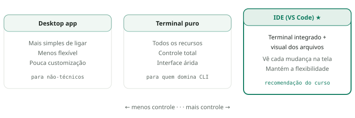
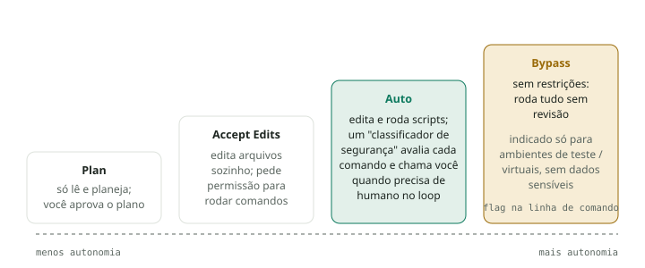
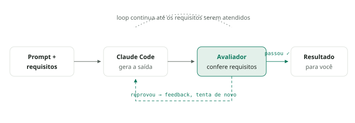
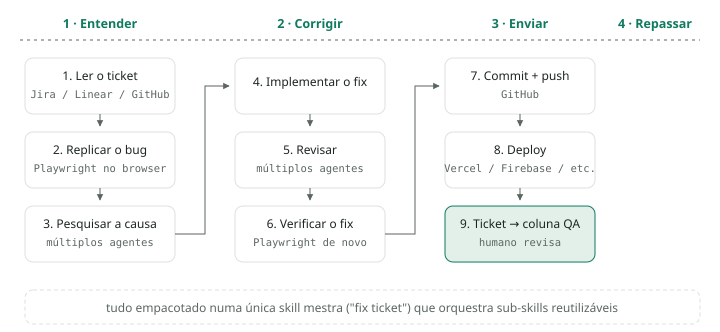
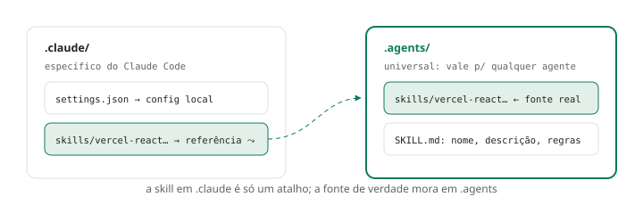
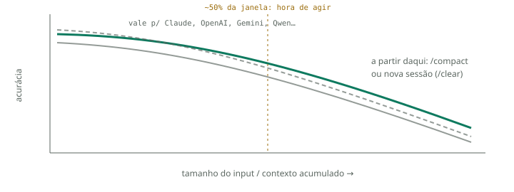
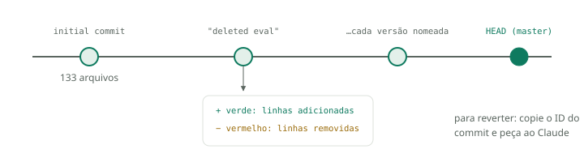
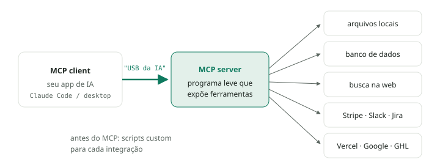
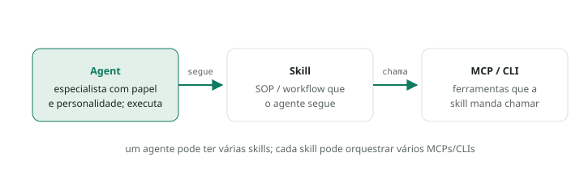

# Apostila — Curso Claude Code do freeCodeCamp (Eric Tech)

## Pergunta

Como estudar, com mais profundidade que o resumo de fonte, o curso "Claude Code Full Course – Autonomous Goals, MCP, and VS Code Setup" (freeCodeCamp.org, 2026-08-05, 1h21), reorganizando o conteúdo em capítulos didáticos com ilustrações?

## Conclusão

Esta página é uma **apostila**: reorganiza a transcrição do curso em 11 capítulos na ordem didática original, com 9 diagramas (em `wiki/assets/`), tabelas, glossário e perguntas de revisão. O resumo enxuto e a avaliação da fonte continuam em [sources/2026-08-05_source-claude-code-full-course-freecodecamp.md](../sources/2026-08-05_source-claude-code-full-course-freecodecamp.md). A apostila também existe como página web (artifact privado no claude.ai, 2026-11-15), da qual este arquivo é a versão em Markdown.

## Como ler esta apostila

- **Natureza da fonte**: curso em vídeo de criador independente ("Eric", canal Eric Tech; apresenta-se como ex-engenheiro de Amazon/Microsoft — não verificado). Misto de **demonstração ao vivo** (dominante), **explicação** e **opinião** (FAQ, comparações). Opiniões aparecem atribuídas ao instrutor.
- **Qualidade da transcrição**: legenda automática em inglês; "Cloud Code"/"Clocko"/"ClawCode" = *Claude Code*; "NestJS" no contexto do projeto é quase certamente *Next.js* (aparece com React e SortableJS); "Sonic" = *Sonnet*.
- **Atenção**: nem tudo é recurso nativo do Claude Code — o `/goal` e a status line customizada são adições do instrutor (sinalizado nos capítulos).

---

## Capítulo 01 — Instalação e onde usar

Promessa do curso: levar um iniciante absoluto (não precisa ser desenvolvedor) ao domínio do Claude Code em ~60 minutos, com um laptop e uma assinatura do Claude.

**Instalação**: documentação oficial → *Quick start* → **native install** (recomendado) para o seu SO → copiar o comando e rodar no terminal.

| Superfície | Prós | Contras |
|---|---|---|
| Desktop app | Simples de ligar | Menos flexível, pouca customização; "para não técnicos" |
| Terminal puro | Todos os recursos, controle total | Interface árida |
| **IDE (VS Code)** ★ | Terminal integrado **+** visual dos arquivos alterados | — (recomendação do instrutor) |

## Capítulo 02 — VS Code e a primeira sessão

- **Preparo**: instalar o VS Code; *Open Folder* para criar/abrir a pasta do projeto (o Explorer reflete o disco); atalhos citados: `Cmd +/-` (zoom), `Cmd+S` (salvar), ``Ctrl+` `` (terminal); tema em *Themes → Color Theme* (o instrutor usa Solarized Light).
- **Ciclo de vida da sessão**: `claude` inicia; a resposta mostra tempo, tokens e % da janela de contexto; `Ctrl+C` 2× encerra; `/resume` retoma sessão anterior (a partir de resumo ou da sessão completa); `clear` limpa o shell (comando do terminal, não do Claude).
- **Primeira demonstração de agência**: "crie um arquivo example com um texto qualquer" → o Claude **escreve de verdade no disco** — a diferença fundamental frente a um chat comum, que só devolve texto.

## Capítulo 03 — Modos de permissão

Alternados com `Shift+Tab`; o quinto modo só aparece iniciando com `claude --dangerously-skip-permissions`.

- **Plan** — só lê e planeja; você aprova o plano. Indicado para refatorações complexas, revisões e projetos do zero.
- **Accept Edits** — edita arquivos sozinho; comandos de shell pedem aprovação.
- **Auto** — também roda scripts, com um "classificador de segurança" (IA) que avalia cada comando e chama o humano quando necessário.
- **Bypass** — sem revisão; o instrutor recomenda apenas em ambiente descartável/sem dados sensíveis.

## Capítulo 04 — Plan mode + `/goal`: o loop autônomo

> **Não é recurso nativo**: o `/goal` é um comando/skill do próprio instrutor. O padrão por trás (gerar → avaliar → corrigir em loop) é a ideia transferível.

Mecânica: um **avaliador** compara cada saída com os requisitos declarados; se não atende, devolve feedback e o Claude regenera — até o critério ser satisfeito. Segundo o instrutor, a acurácia fica bem acima do fluxo prompt→resposta simples.

**Caso prático — clonar um app de tier list** (plan mode + loop):

1. **Entrada rica**: screenshot do app arrastado ao prompt + link da página; instrução de extrair features, assets e funcionalidades e planejar antes de executar.
2. **Perguntas de clarificação** devolvidas pelo Claude: stack ("Next.js + React" — a legenda diz "NestJS", provável ruído; alternativas incluíam vanilla e SortableJS), manter ou não o *email gate*, conteúdo das peças e **nível de fidelidade**: "funcional" ou "pixel perfect" (mesmas fontes/estilos, diferença ≤ 2% — critério que vira a **condição de parada do loop**).
3. **Plano gerado**: contexto, decisões, bibliotecas de drag-and-drop, design tokens extraídos do original, modelo de dados, estrutura de arquivos.
4. **Refino**: o instrutor pede para baixar todos os SVGs do app original *antes* de construir (o agente não precisa adivinhar assets); plano regenerado.
5. **Execução**: aprovação com bypass; ao final, dev server local serve o clone funcional (link local, não abre para terceiros).

Menção de passagem: botão "refine with Ultra Plan" (geraria wireframes num app web; deixado para outro vídeo).

> **Padrão transferível**: critérios de aceitação *mensuráveis* (ex.: "diferença ≤ 2%") transformam requisitos vagos em condição de parada objetiva para um agente em loop.

## Capítulo 05 — Skills: SOPs para o agente

Definição do curso: skill = **workflow, guia ou SOP** que ensina o agente a executar uma tarefa de forma **reutilizável** — vale para qualquer LLM.

**Exemplo âncora — skill "fix ticket"** (experiência pessoal do instrutor): pipeline de correção de bugs com 9 passos em 4 estágios, numa skill mestra que chama sub-skills.

**Instalar, acionar e remover**:

- `/plugins` abre a descoberta (demo: *frontend-design*, skill da própria Anthropic que "renova" o visual de um app); depois, `/reload plugins` (grafia da legenda) aplica a mudança.
- **Escopos**: (a) usuário — global na máquina; (b) projeto — todos que clonarem o repositório; (c) projeto, só para você.
- **Via link**: colar a URL de uma skill (demo: *Vercel React best practices*, ~70 regras priorizadas por impacto) e pedir para instalar.
- **Catálogo**: **skills.sh** — skills para qualquer agente (Claude Code, Codex etc.).
- **Acionar**: linguagem natural ("use a skill de frontend design") ou slash direto (`/frontend-design`).
- **Remover**: via `/plugins` ou apagando a pasta da skill e reiniciando a sessão.

## Capítulo 06 — Anatomia do projeto gerado

| Item | O que é |
|---|---|
| `*.md` | Documentação em Markdown |
| `package.json` | Dependências e comandos de que o app depende |
| `package-lock.json` | Gerado na instalação; não requer atenção |
| `public/` | Assets públicos: logos, imagens, SVGs |
| `node_modules/` | Bibliotecas instaladas; nunca se edita; fora do versionamento |
| `.gitignore` | O que o Git deve ignorar (ex.: `node_modules`) |
| `lib/` | Funções e configurações de apoio |
| `evals/` | Criado pelo loop do `/goal`; temporário, pode ser apagado |
| `components/` | Peças reutilizáveis da interface ("Lego") |
| `app/` | Monta as páginas juntando componentes (ex.: `page.tsx`) |
| Pastas `.xxx` | Ocultas; privadas de ferramentas (`.next`, `.playwright`…) |

**`.claude` vs `.agents`**: skills instaladas moram em `.agents/` (universal, para qualquer framework de agente); `.claude/` referencia essa fonte (link simbólico) e guarda só o que é exclusivo do Claude Code (`settings.json`).

**`CLAUDE.md` e `AGENTS.md`** seguem a mesma lógica (específico × universal) e funcionam como *system prompt* do projeto: lidos em **toda** interação. Demo: a regra "responda só com emojis" no arquivo muda o comportamento de qualquer prompt; removida, volta ao normal.

## Capítulo 07 — Contexto e context rot

- **Janela de contexto** = orçamento total de tokens da conversa (1M no modelo da demo). `/context` mostra o mapa de uso por categoria (system prompt, skills, memórias, mensagens — a maior fatia na demo).
- **Customização do autor**: a status line com % de contexto e tokens não vem pronta; foi construída com prompt próprio (distribuído na descrição do vídeo).
- **Context rot**: quanto maior o contexto acumulado, menor a acurácia — em todos os fornecedores. Heurística do instrutor: passou de ~50% da janela → `/compact` ou nova sessão.

- `/compact` resume a conversa e libera contexto (na demo, 26% → 7%); **custo**: o resumo pode perder informações.
- `/clear` zera tudo.

## Capítulo 08 — Slash commands

Definição do curso: atalhos embutidos *ou* gatilhos definidos pelo usuário que começam com `/` (skills instaladas também viram slash commands).

| Comando | O que faz |
|---|---|
| `/clear` | Zera conversa e contexto |
| `/compact` | Resume a conversa para liberar contexto (com risco de perda) |
| `/context` | Mapa do uso da janela por categoria |
| `/resume` | Retoma sessão anterior (resumo ou completa) |
| `/rewind` | Restaura código **e** conversa a um checkpoint |
| `/model` | Troca o modelo (na demo: Opus 4.8, Fable, Sonnet 5, Haiku) |
| `/mcp` | Gerencia servidores MCP |
| `/plugins` | Descobre, instala e desinstala plugins/skills |
| `/reload plugins` | Recarrega plugins após instalar (grafia da legenda) |
| `/nome-da-skill` | Aciona uma skill diretamente |

O `/rewind` é um "ctrl+Z de sessão" — e a ponte para o tema seguinte: para versionamento de verdade, Git.

## Capítulo 09 — Git e GitHub

Motivação: o rewind não sobrevive a um desligamento nem serve para equipes. Controle de versão dá histórico completo, colaboração sem sobrescritas e restauração de qualquer ponto — grátis no GitHub.

- **Criar repositório via Claude**: "crie um repositório privado para esta pasta e commite" → 133 arquivos no commit inicial, `node_modules`/`.next` excluídos via `.gitignore`, nenhum `.env`/segredo enviado (o agente confirma).
- **Leitura visual**: no Explorer do VS Code, arquivos acinzentados = ignorados pelo Git.
- **Fluxo de mudança pela interface**: deletar `evals/` → Source Control acusa 7 mudanças → mensagem ("deleted eval") → stage, commit, sync → GitHub mostra a nova versão.
- **Branches**: linhas paralelas (ex.: "v2"); a demo usa só `master` (default do `git init`; renomeável para `main`).
- **Colaboração**: Settings → Collaborators.
- **Reverter**: copiar o commit ID e pedir ao Claude o rollback.

## Capítulo 10 — MCP e ferramentas CLI

Próximo nível: o Claude Code operar os apps do dia a dia (Jira, Slack, Stripe, Vercel, Facebook). Duas vias: **MCP** e **ferramentas CLI**.

| | Ferramenta CLI | MCP |
|---|---|---|
| **O que é** | Agente executa comandos de shell | Protocolo padronizado expondo ferramentas controladas |
| **Tokens** | **Muito eficiente** | Consome mais (schemas carregados no contexto) |
| **Segurança/controle** | Depende dos comandos gerados | Escolha de tools, autenticação, trilha de auditoria |
| **Melhor para** | Velocidade e economia | Times, multi-tenant, controle de acesso |

**Demo — deploy na Vercel**: perguntar se a CLI/MCP da Vercel está no sistema (se não, colar o link da documentação e deixar conectar) → "crie um projeto na minha conta e faça o deploy" → app no ar em **link público** em segundos → para despublicar, pedir para deletar; antes de deletar, o agente **confere a conta** (3 projetos, 2 de produção intocados) e remove só o correto. Também citados: Stripe (CLI e MCP), Google/Gemini CLI, GoHighLevel MCP.

## Capítulo 11 — FAQ do instrutor

- **Skills × MCPs × Agents**: skill = SOP; MCP = ferramenta; agent = especialista com papel/personalidade. O agente *segue* skills; skills *chamam* MCPs/CLIs. (Subagentes ficam para um vídeo futuro.)
- **É para iniciantes?** Sim — VS Code + terminal + `claude` basta; o terminal revela customizações que o desktop não tem.
- **Vs. Codex/Gemini?** *(opinião)* Todos são **frameworks**; o modelo é o motor e pode ser trocado (OpenRouter, locais). Para o instrutor, o Claude Code é o framework mais rico (plugins, orquestração).
- **Preciso de Git/GitHub?** Para projeto de longo prazo, sim: sem versionamento não há rollback se o agente apagar algo indevido.
- **O plano de US$ 20 basta?** *(opinião)* Para aprender, sim; uso diário intenso estoura os limites de 5h. Alternativas sugeridas: modelos locais ou OpenRouter (cita DeepSeek).
- **É seguro?** Sim, com o modo de permissão certo (cap. 03).
- **Preciso do Cursor?** Não — Cursor, VS Code, Antigravity são todos IDEs; VS Code basta para começar.
- **Fica obsoleto em um mês?** *(opinião)* Não: modelos mudam, fundamentos (sessões, permissões, contexto, skills, Git, MCP) permanecem.

**Temas anunciados para vídeo futuro (não cobertos)**: subagentes, spec-driven development, rodar "de graça", knowledge graph, IA local, Claude designs, "ultra code", workflows dinâmicos.

## Glossário rápido

| Termo | Definição |
|---|---|
| IDE | Editor + explorador de arquivos + terminal numa janela (VS Code, Cursor…) |
| Janela de contexto | Orçamento total de tokens de uma conversa |
| Context rot | Queda de acurácia conforme o contexto acumulado cresce |
| Skill | SOP/workflow em arquivo que instrui o agente de forma repetível |
| Plugin | Pacote instalável (via `/plugins`) que pode trazer skills |
| MCP | Protocolo que conecta apps de IA (clients) a ferramentas (servers) |
| Ferramenta CLI | Programa de linha de comando operado via comandos de shell |
| Commit | Versão nomeada do projeto no Git (diff: verde = adições, vermelho = remoções) |
| Repositório | O "projeto" no controle de versão (público ou privado) |
| Branch | Linha paralela de desenvolvimento (`master`/`main`, "v2") |
| Deploy | Publicar a aplicação num servidor acessível ao público |
| System prompt | Regras lidas em toda interação (`CLAUDE.md`/`AGENTS.md`) |

## Perguntas de revisão

1. **Por que usar o Claude Code dentro de um IDE?** → Une o poder total da CLI (que o desktop não expõe) à visualização de arquivos (que o terminal puro não dá).
2. **Auto × Bypass?** → Ambos rodam scripts sem perguntar, mas o Auto tem classificador de segurança que escala ao humano; o Bypass roda tudo sem revisão (só ambiente descartável).
3. **O que o avaliador do `/goal` faz e por que "≤ 2%" importa?** → Compara saída com requisitos e dá feedback até passar; critério mensurável = condição de parada objetiva.
4. **Onde mora a fonte de verdade de uma skill e o que fica em `.claude`?** → Em `.agents/` (universal); `.claude/` referencia e guarda só o específico (`settings.json`).
5. **Trade-off `/compact` × `/clear`?** → Compact preserva resumo (pode perder detalhes); clear zera tudo e garante contexto limpo.
6. **`/rewind` × Git?** → Rewind volta código+conversa a checkpoints da sessão; Git dá histórico permanente, nomeado, colaborativo.
7. **Quando CLI e quando MCP?** → CLI: velocidade/economia de tokens; MCP: controle de tools, autenticação, auditoria — times.
8. **Agente ___ skill, skill ___ MCP/CLI.** → *segue*; *chama*.

## Quais páginas foram usadas como evidência

- [Resumo da fonte (freeCodeCamp)](../sources/2026-08-05_source-claude-code-full-course-freecodecamp.md) — e a transcrição bruta em `raw/sources/`.

## Incertezas

- `/goal` e status line são customizações do instrutor; "Ultra Plan" não explicado; grafias exatas de comandos não verificadas na documentação oficial (ver [open-questions](../open-questions.md)).
- Credenciais do instrutor (ex-Amazon/Microsoft) não verificadas; componente promocional (comunidade paga) presente.
- Alegações comparativas ("Claude Code é o melhor framework") são opinião atribuída, não fato.

## Próximas ações

- Quando a documentação oficial for consultada, atualizar aqui e na fonte os nomes exatos (status line, `/reload plugins`, flag de bypass).
